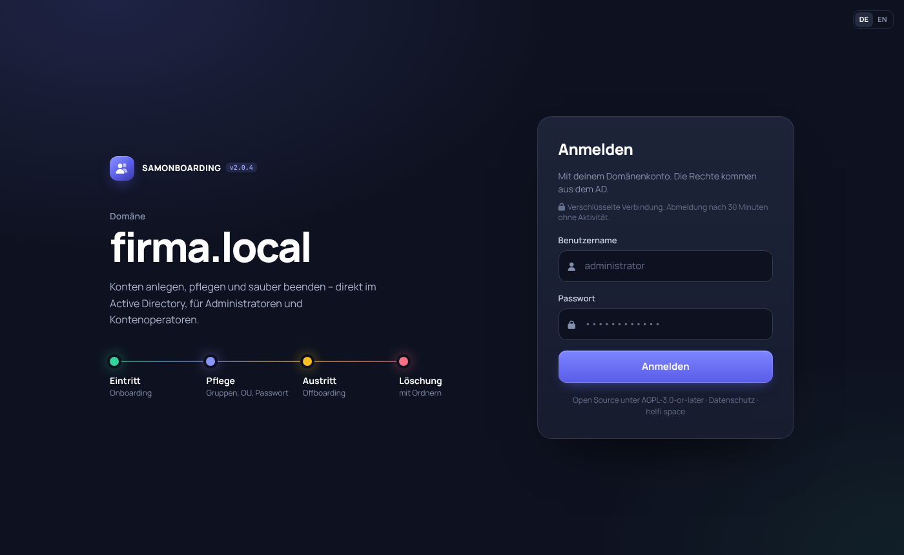
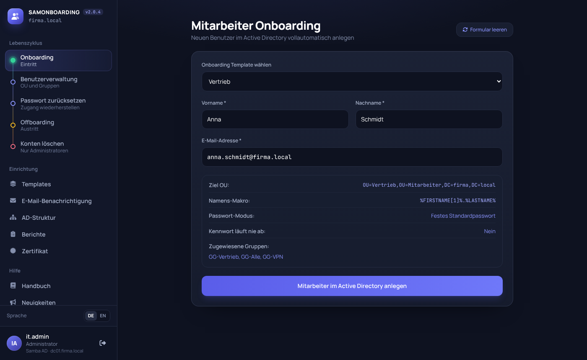
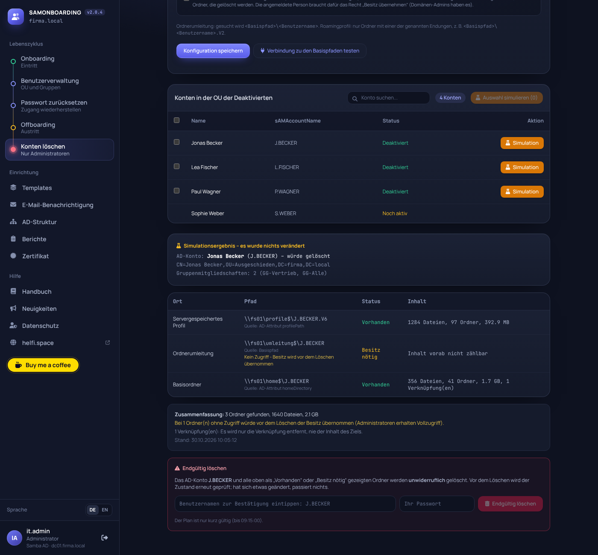

# SAMONBOARDING

*English version: [README.md](README.md)* · **Handbuch: [HANDBUCH.md](samonboarding/web/manual/HANDBUCH.md)** · **Datenschutz (DSGVO): [DATENSCHUTZ.de.md](DATENSCHUTZ.de.md)** · Webseite: [helfi.space](https://helfi.space) · Lizenz: [AGPL-3.0-or-later](LICENSE) · Änderungen: [CHANGELOG.de.md](CHANGELOG.de.md)

Webanwendung für die tägliche Benutzerverwaltung im Active Directory (**Samba AD** oder **Windows Server AD**):

| Modul | Was es macht |
|---|---|
| **Onboarding** | Legt neue Benutzer anhand eines Templates an (Namensschema, OU, Passwort, Gruppen, weitere Attribute) |
| **Offboarding** | Deaktiviert ein Konto, entfernt es aus allen Gruppen und verschiebt es in eine Ziel-OU |
| **Passwort zurücksetzen** | Setzt Passwörter zurück (Zufall oder manuell), kann Kontosperren aufheben und Änderung beim nächsten Login erzwingen |
| **Benutzerverwaltung** | Verschiebt Konten zwischen erlaubten OUs und pflegt Gruppenmitgliedschaften |
| **Wiederherstellen** | Macht ein versehentliches Offboarding rückgängig (OU, Gruppen, aktiv) |
| **Konten löschen** | Nur Administratoren: löscht deaktivierte Konten samt Profil, Ordnerumleitung und Basisordner, immer erst als Simulation |
| **E-Mail-Benachrichtigung** | Optional: Mail an den ausführenden Mitarbeiter (SMTP) |

Die Anwendung läuft als Docker-Container (FastAPI + ldap3), die Oberfläche ist komplett eingebaut und braucht kein Internet.



> **Bitte vor dem Einsatz lesen**
>
> - **Freizeitprojekt, ohne Gewähr.** SAMONBOARDING ist für den eigenen Bedarf entstanden und wird in der Freizeit gepflegt. Es gibt keine Gewährleistung und keine Haftung (Abschnitte 15 und 16 der [Lizenz](LICENSE)).
> - **Das Programm hat weitreichende Rechte.** Es legt Konten an, setzt Passwörter zurück und löscht Konten und Ordner. Probiere es zuerst in einer **Testumgebung** aus und lege vor dem ersten Einsatz im echten AD eine Sicherung an.
> - **Getestet mit Samba AD.** Windows Server AD wird unterstützt, ist aber weniger erprobt (zum Beispiel mehrere DCs, Exchange, große Strukturen). Rückmeldungen dazu sind willkommen.
> - **Feste Version für den Betrieb.** `latest` wird jede Woche automatisch neu gebaut, getestet und geprüft, aber nicht gegen ein echtes AD. Wer Änderungen erst selbst prüfen möchte, trägt eine feste Version ein, zum Beispiel `SAMONBOARDING_VERSION=2.0` in der `.env` (siehe [Version festlegen und zurückgehen](#version-festlegen-und-zurückgehen)).
> - **Kein Support.** Fragen und Fehlerberichte werden gelesen, beantwortet aber nur nach verfügbarer Zeit. **Sicherheitslücken** bitte nicht öffentlich melden, sondern wie in [SECURITY.md](SECURITY.md) beschrieben. Beiträge: siehe [CONTRIBUTING.md](CONTRIBUTING.md).

---

## Inhalt

1. [So funktioniert es](#1-so-funktioniert-es)
2. [Voraussetzungen](#2-voraussetzungen)
3. [Installation](#3-installation)
4. [Konfiguration](#4-konfiguration)
5. [Active Directory vorbereiten](#5-active-directory-vorbereiten)
6. [Ersteinrichtung in der Oberfläche](#6-ersteinrichtung-in-der-oberfläche)
7. [Die Module im Detail](#7-die-module-im-detail)
8. [Betrieb](#8-betrieb)
9. [Sicherheitshinweise](#9-sicherheitshinweise)
10. [Fehlersuche](#10-fehlersuche)
11. [Entwicklung](#11-entwicklung)

---

## 1. So funktioniert es

```
 Browser  ──HTTPS──▶  SAMONBOARDING (Docker, Port 9500)  ──LDAPS 636──▶  Domain Controller
                                   │
                                   └──SMTP (optional)──▶  Mailserver
```

Diese fünf Punkte erklären das ganze Konzept:

1. **Es gibt kein Dienstkonto.** Jeder meldet sich mit seinem *eigenen* AD-Konto an. Alle Aktionen laufen im Namen dieses Benutzers. Was das AD ihm nicht erlaubt, kann er auch hier nicht tun. Die Rechte werden also im AD vergeben (Delegierung), nicht in der Anwendung.
2. **Die Verbindung zum DC ist verschlüsselt (LDAPS, Port 636).** Das ist nötig, weil AD das Setzen von Passwörtern nur über eine verschlüsselte Verbindung erlaubt.
3. **Zwei Rollen**, abhängig von den Gruppen des angemeldeten Benutzers (verschachtelte Mitgliedschaften zählen mit):

   | Rolle | Voraussetzung | Darf |
   |---|---|---|
   | **Administrator** | Mitglied in `Domänen-Admins`, `Organisations-Admins` oder `Administratoren` (erkannt an der SID, auch mit englischen Namen) | alles, inklusive Einstellungen, Templates, SMTP und Freigabe der OUs |
   | **Account Operator** | Mitglied in `Account Operators` **oder** in der selbst festgelegten Gruppe (`CUSTOM_OPERATOR_GROUP`) | Onboarding, Offboarding, Passwort-Reset und Benutzerverwaltung, aber nur in den vom Administrator freigegebenen OUs |

   Alle anderen werden beim Login abgewiesen.
4. **Freigegebene OUs.** Der Administrator legt in der Oberfläche fest, in welchen OUs gearbeitet werden darf. Der Server prüft das bei jeder Aktion zusätzlich, nicht nur die Oberfläche.
5. **Nur HTTPS, Sitzungen nur im Arbeitsspeicher.** Die Anwendung ist ausschließlich über HTTPS erreichbar. Sitzungen (inklusive Passwort, das für die Aktionen im AD gebraucht wird) enden bei der Abmeldung, nach **30 Minuten ohne Aktivität** oder beim Neustart des Containers. Jede Aktion wird in den **Berichten** festgehalten (SQLite, ohne Passwörter).

---

### Oberfläche

Die Navigation folgt dem Lebenszyklus eines Kontos: **Eintritt** (Onboarding), **Pflege** (Benutzerverwaltung, Passwort zurücksetzen), **Austritt** (Offboarding) und **Löschung**. Darunter liegen Einrichtung (Templates, E-Mail-Benachrichtigung, AD-Struktur) und Hilfe. Rückmeldungen erscheinen als Meldung unten rechts. Fehler und lange Meldungen bleiben stehen, bis sie geschlossen werden. Auf Tablet und Handy klappt die Navigation über das Menü-Symbol oben links auf.

**Sprache:** Die Oberfläche gibt es auf **Deutsch und Englisch**. Umgeschaltet wird mit *DE / EN* unten in der Seitenleiste oder oben rechts auf der Anmeldeseite. Die Wahl merkt sich der Browser; beim ersten Aufruf gilt die Sprache des Browsers. Meldungen des Servers und die Benachrichtigungs-Mails kommen in der gewählten Sprache. Namen, OUs, Gruppen und Pfade aus dem AD werden nie übersetzt. Die englischen Texte stehen in `samonboarding/web/i18n.json` (deutscher Text → englischer Text, mit Platzhaltern `{0}` für Werte).

Farben und Schriften stehen in `samonboarding/web/theme.json`. Nach einer Änderung dort wird ein neues Image gebaut (siehe [Abschnitt 11](#11-entwicklung)).

## 2. Voraussetzungen

- Ein Linux-Server, eine VM oder ein NAS (z. B. **Synology** mit *Container Manager*) mit **Docker** und **Docker Compose** (`docker compose` oder `docker-compose`)
- Der Server erreicht den Domain Controller über **TCP 636** (LDAPS) und kann dessen Namen auflösen
- Ein **Domain Controller** mit aktiviertem LDAPS (siehe [Abschnitt 5](#5-active-directory-vorbereiten))
- Optional: ein SMTP-Server für Benachrichtigungen

Das Programm steckt komplett im Image. Auf dem Server liegen nur drei Dinge:

```
/opt/samonboarding/          (Ordner frei wählbar)
├── docker-compose.yml       ← aus dem Release, nicht anpassen
├── .env                     ← deine Einstellungen
└── data/                    ← alles, was das Programm speichert (legt Docker beim ersten Start an)
    └── backups/             ← Sicherungen vor jedem Versionswechsel (legt das Programm an)
```

---

## 3. Installation

### Schritt 1: Dateien holen

Die Dateien `docker-compose.yml` und `env.example` hängen an jedem Release auf GitHub (*Releases* → neueste Version → *Assets*). Auf dem Server:

```bash
sudo mkdir -p /opt/samonboarding && cd /opt/samonboarding
# docker-compose.yml und env.example aus dem neuesten Release hierher laden, dann:
sudo cp env.example .env
```

Ist das Repository privat, ist auch das Image privat. Dann einmalig anmelden (Benutzer = GitHub-Konto, Passwort = Token mit dem Recht *read:packages*): `sudo docker login ghcr.io`.

### Schritt 2: Einstellungen in `.env` eintragen

Deine Einstellungen stehen in der Datei **`.env`**, nicht in der `docker-compose.yml`. Die `.env` gehört dir und wird nie überschrieben.

```bash
sudo nano .env
```

Mindestens diese Werte anpassen:

```ini
AD_DOMAIN=firma.local
AD_DC_IP=10.0.10.5
CUSTOM_OPERATOR_GROUP=CO-ADMIN
```

Alle weiteren Einstellungen (Version, Port, Zeitzone, Zertifikat, Löschfristen …) stehen kommentiert in der `.env`, die Bedeutung in [Abschnitt 4](#4-konfiguration). Kommentare bitte nur in eigene Zeilen schreiben (mit `#` am Zeilenanfang), nicht hinter einen Wert. Eine CA-Datei für den DC (`LDAP_CA_FILE`) muss im Datenordner liegen, z. B. `data/ca.pem` (im Container `/app/data/ca.pem`).

Brauchst du etwas, das nicht über die `.env` geht (z. B. einen eigenen DNS-Server für den Container), lege eine **`docker-compose.override.yml`** an. Docker liest sie automatisch zusätzlich ein; sie wird nie ersetzt.

### Schritt 3: Starten

```bash
sudo docker compose up -d
```

Docker holt das Image und startet den Container. Beim ersten Start legt es `data/` an; das Programm übergibt den Ordner selbst an seinen eigenen Benutzer (10001) und läuft danach ohne Sonderrechte. Gebaut wird auf dem Server nichts.

### Schritt 4: Prüfen

```bash
sudo docker compose ps          # Status sollte "healthy" sein
sudo docker compose logs -f     # Logs live ansehen (Strg+C beendet die Anzeige)
```

**Kein Internet im Betrieb:** Die Anwendung baut von sich aus keine Verbindungen ins Internet auf, nur zu DC, Dateiserver, SMTP und ggf. Exchange (siehe [Abschnitt 9](#9-sicherheitshinweise)). Wer den Container zusätzlich abschotten will, beschränkt den ausgehenden Verkehr des Docker-Netzes `samonboarding` (Subnetz `DOCKER_SUBNET`) in der Firewall des Hosts, Routers oder NAS. Für Updates ohne Internet siehe [Ohne Internet](#ohne-internet).

### Schritt 5: Anmelden

Öffne `https://<server>:9500` im Browser und melde dich mit einem AD-Konto an, das Administrator ist. Beim ersten Start erzeugt die Anwendung ein **selbstsigniertes Zertifikat**, der Browser zeigt deshalb einmal eine Warnung. Ein eigenes Zertifikat lädst du danach in der Oberfläche unter **Zertifikat** hoch (siehe [HTTPS](#https)). Erlaubt sind diese Schreibweisen:

- `benutzername`
- `benutzername@firma.local`
- `FIRMA\benutzername`

Weiter geht es mit der [Ersteinrichtung](#6-ersteinrichtung-in-der-oberfläche).

### Mit einer Container-Verwaltung (Dockhand, Portainer & Co.)

Einen Stack mit dem Inhalt der `docker-compose.yml` anlegen und die Einstellungen aus der `env.example` als `.env` bzw. als Variablen des Stacks eintragen. Der Datenordner `./data` liegt dann im Ordner des Stacks. Für ein privates Image die Registry `ghcr.io` mit einem Token mit *read:packages* hinterlegen.

### Umstieg von Version 1.x

Bis 1.48 lag das ganze Programm im Ordner auf dem Server (ZIP oder `git clone`, teils selbst gebaut). So geht der Umstieg, Schritt für Schritt:

1. **Einmal das bisherige Update-Skript aufrufen:**
   ```bash
   cd /opt/samonboarding
   sudo sh update.sh --pull
   ```
   Es holt die neue Version, übernimmt das neue `update.sh` und die neue `docker-compose.yml` aus dem Image und startet den Container. Startet er nicht, kommt die vorherige Version zurück. `.env` und `data/` bleiben, wie sie sind. Ein `SAMONBOARDING_IMAGE=…` in der `.env` wird dabei in `SAMONBOARDING_VERSION` übernommen.
2. **Prüfen**, ob alles läuft (`sudo docker compose ps`, Anmeldung in der Oberfläche).
3. **Alte Programmdateien entfernen:**
   ```bash
   sudo sh update.sh --cleanup
   ```
   Das Skript zeigt die Liste der nicht mehr gebrauchten Dateien (Programmordner, alte ZIPs, Versionsordner, Zwischenstände, Reste der früheren Internet-Sperre), fragt nach und löscht nur diese. **Nie** angefasst werden `data/`, `backups/`, `.env`, `docker-compose.yml` (auch `.alt` und `docker-compose.override.yml`), `update.sh` und Ordner, die ein Container eingebunden hat – auch nicht über Verknüpfungen.

Danach liegen nur noch `docker-compose.yml`, `.env`, `data/` (und die alten Sicherungen in `backups/`) im Ordner.

**Daten bisher im Docker-Volume `samonboarding-data`** (Dockhand mit der früheren `docker-compose.image.yml`): einmalig in den Ordner `data` neben der neuen `docker-compose.yml` kopieren, bei gestopptem altem Stack:

```bash
cd /opt/samonboarding     # Ordner mit der neuen docker-compose.yml
sudo docker run --rm --user 0 --entrypoint sh -v samonboarding-data:/von:ro -v "$PWD/data":/nach \
  ghcr.io/soleil0815/samonboarding:latest -c 'cp -a /von/. /nach/'
sudo docker compose up -d
```

Läuft alles, kann das alte Volume mit `sudo docker volume rm samonboarding-data` gelöscht werden.

## 4. Konfiguration

Ob das Verzeichnis ein **Samba AD** oder ein **Windows Server AD** ist, wird beim Anmelden automatisch erkannt (RootDSE) und oben neben der Rolle angezeigt. Eine Einstellung ist dafür nicht nötig.

Alle Einstellungen stehen in der Datei **`.env`** (Vorlage: `env.example` am Release bzw. `.env.example` im Repository). Nach einer Änderung: `docker compose up -d` (der Container wird dabei neu erstellt). Ein leerer Wert bedeutet: Standardwert (Ausnahme `TZ`: leer heißt UTC).

| Variable | Standard | Bedeutung |
|---|---|---|
| `AD_DOMAIN` | `firma.local` | DNS-Name der Domäne (nicht der NetBIOS-Name). Daraus wird die Suchbasis gebildet: `firma.local` → `DC=firma,DC=local` |
| `AD_DC_IP` | `10.0.10.5` | IP-Adresse oder Name des Domain Controllers |
| `CUSTOM_OPERATOR_GROUP` | leer | sAMAccountName einer zusätzlichen Gruppe, deren Mitglieder Operatoren sind. Die eingebaute Gruppe *Konten-Operatoren* (Account Operators) gilt immer, erkannt an ihrer SID |
| `LDAP_CA_FILE` | leer | Pfad (im Container) zu einer CA-Datei im PEM-Format. Gesetzt: Das Zertifikat des DC wird geprüft |
| `LDAP_ALLOW_PLAIN` | `false` | `true` = Fallback auf unverschlüsseltes LDAP (Port 389), falls 636 nicht erreichbar ist. Passwörter gehen dann im Klartext übers Netz – nur im Notfall |
| `SESSION_IDLE_MINUTES` | `30` | Abmeldung nach so vielen Minuten ohne Aktivität |
| `SESSION_MAX_HOURS` | `12` | Höchstdauer einer Sitzung, auch bei durchgehender Aktivität. Danach neu anmelden (die Rolle wird dabei neu bestimmt) |
| `HTTPS_PORT` | `9500` | Port für HTTPS im Container. Einen HTTP-Port gibt es nicht |
| `TLS_HOSTNAMES` | leer | Namen und IPs für das selbstsignierte Zertifikat, Komma-getrennt (z. B. `samonboarding.firma.local,10.0.10.20`) |
| `TLS_CERT_FILE`, `TLS_KEY_FILE` | `data/tls/cert.pem`, `data/tls/key.pem` | Eigenes Zertifikat und Schlüssel (PEM) |
| `LOGIN_MAX_ATTEMPTS` | `5` | Fehlversuche je Benutzer und IP, bis zeitweise gesperrt wird |
| `LOGIN_LOCK_MINUTES` | `5` | Dauer der Sperre in Minuten |
| `DATA_DIR` | `<Projekt>/data` | Speicherort für Daten (im Container `/app/data`) |
| `TZ` | `Europe/Berlin` | Zeitzone für Berichte und Mails (z. B. `Europe/Vienna`, `UTC`) |
| `DOCKER_SUBNET` | `172.30.80.0/24` | Subnetz des Docker-Netzes des Containers. Nur ändern, wenn es sich mit deinem Netz überschneidet |
| `AUDIT_RETENTION_DAYS` | `365` | Datenschutz: Berichte (Änderungen), die älter sind, werden täglich gelöscht. `0` = unbegrenzt |
| `LOG_RETENTION_DAYS` | `90` | Datenschutz: Protokoll-Einträge, die älter sind, werden täglich gelöscht. `0` = unbegrenzt |
| `OFFBOARD_RETENTION_DAYS` | `180` | Datenschutz: Wiederherstellungs-Einträge werden so viele Tage nach dem Offboarding gelöscht. `0` = unbegrenzt |

Hinweise:

- **Zertifikatsprüfung:** Standardmäßig vertraut die Anwendung dem LDAPS-Zertifikat des DC automatisch, auch einem selbstsignierten (Samba) oder einem aus der eigenen Firmen-CA. Es muss nichts importiert werden. Die Verbindung ist trotzdem verschlüsselt, aber ohne Prüfung könnte sich jemand im Netz als DC ausgeben und die Passwörter der Anmeldenden mitlesen (Man-in-the-Middle). **Empfohlen** ist deshalb `LDAP_CA_FILE` (siehe [Abschnitt 5](#5-active-directory-vorbereiten)). Dann muss `AD_DC_IP` der Name sein, der im Zertifikat steht.
- **Namensauflösung:** Wenn du einen Namen statt einer IP bei `AD_DC_IP` einträgst, muss der Docker-Host diesen Namen auflösen können. Wenn nicht, trage den DNS-Server des AD in eine `docker-compose.override.yml` ein (bleibt bei Updates erhalten):

  ```yaml
  services:
    samonboarding:
      dns:
        - 10.0.10.5
  ```
- Liegt eine Datei `data/config.json` vor, **hat sie Vorrang** vor den Umgebungsvariablen `AD_DOMAIN` und `AD_DC_IP`. Die Anwendung legt diese Datei nicht selbst an.

---

## 5. Active Directory vorbereiten

Die Vorbereitung besteht immer aus denselben drei Dingen:

1. **LDAPS** auf dem Domain Controller (Port 636)
2. Optional: eine **Operator-Gruppe** (`CUSTOM_OPERATOR_GROUP`)
3. **Rechte** für die Operatoren auf den betroffenen OUs

Der Test, ob LDAPS erreichbar ist (vom Docker-Host aus):

```bash
openssl s_client -connect 10.0.10.5:636 -showcerts </dev/null
```

Wird ein Zertifikat angezeigt, ist LDAPS aktiv. Kommt `connection refused` oder ein Timeout, ist Port 636 nicht offen oder blockiert.

### 5.1 Samba AD

**LDAPS:** Samba aktiviert TLS standardmäßig und erzeugt beim Provisionieren ein selbstsigniertes Zertifikat. Üblicherweise liegt es in `/var/lib/samba/private/tls/` (`ca.pem`, `cert.pem`, `key.pem`; je nach Installation kann der Pfad abweichen). Das genügt für den Start. Bei einem Test mit `openssl s_client` solltest du ein Zertifikat sehen.

**Operator-Gruppe anlegen (optional):**

```bash
samba-tool group add CO-ADMIN
samba-tool group addmembers CO-ADMIN benutzer1,benutzer2
samba-tool group listmembers CO-ADMIN
```

`CO-ADMIN` ist nur ein Beispiel: Den Namen wählst du selbst (z. B. `Onboarding-Operatoren`), er muss nur im AD und in der `.env` gleich sein. Der Gruppenname ist der `sAMAccountName` und kommt bei `CUSTOM_OPERATOR_GROUP` in die `.env`. Alternativ gehören Operatoren zur eingebauten Gruppe `Account Operators`:

```bash
samba-tool group addmembers "Account Operators" benutzer1
```

**Rechte:** Die eingebaute Gruppe `Account Operators` hat normalerweise Rechte zum Verwalten von Benutzern und Gruppen. Wenn du eine eigene Gruppe (`CO-ADMIN`) verwendest, muss sie diese Rechte auf den OUs bekommen, mit denen gearbeitet wird. Das geht mit `samba-tool dsacl set` oder von einem Windows-Client mit RSAT aus (siehe Samba-Dokumentation). Am einfachsten ist es, Operatoren in `Account Operators` zu lassen.

**Passwortrichtlinie:** Zurückgesetzte und neue Passwörter müssen die Richtlinie erfüllen. Anzeigen:

```bash
samba-tool domain passwordsettings show
```

**Zertifikatsprüfung aktivieren (optional):**

1. `ca.pem` vom DC nach `./data/ca.pem` kopieren
2. In der `.env`: `LDAP_CA_FILE=/app/data/ca.pem` und bei `AD_DC_IP` den DNS-Namen des DC eintragen (zum Beispiel `dc1.firma.local`)
3. Welcher Name im Zertifikat steht, zeigt `openssl x509 -in cert.pem -noout -subject -ext subjectAltName`

### 5.2 Windows Server AD

**LDAPS:** Der Domain Controller braucht ein Zertifikat mit dem Verwendungszweck *Serverauthentifizierung*, in dem der DNS-Name des DC steht. Am einfachsten geht das mit einer **Active Directory-Zertifikatdienste (AD CS)**-Unternehmens-CA. Domain Controller bekommen dann automatisch ein passendes Zertifikat, und LDAPS ist auf Port 636 verfügbar. Ohne CA kannst du ein Zertifikat auch manuell ausstellen und im Computerzertifikatspeicher des DC (Eigene Zertifikate) installieren.

Test auf dem DC oder einem Server in der Domäne:

```powershell
Test-NetConnection dc1.firma.local -Port 636
```

Oder mit dem Programm `ldp.exe`: *Verbindung → Verbinden…*, Port `636`, Haken bei *SSL*.

**Operator-Gruppe anlegen (optional):**

```powershell
New-ADGroup -Name "CO-ADMIN" -GroupScope Global -GroupCategory Security -Path "OU=Gruppen,DC=firma,DC=local"
Add-ADGroupMember -Identity "CO-ADMIN" -Members benutzer1,benutzer2
```

**Rechte delegieren** (für `CO-ADMIN` oder eine andere eigene Gruppe): In *Active Directory-Benutzer und -Computer* mit Rechtsklick auf die OU → *Objektverwaltung zuweisen…* und diese Aufgaben auswählen:

| Aufgabe | Wofür |
|---|---|
| Benutzerkonten erstellen, löschen und verwalten | Onboarding, Offboarding (Deaktivieren, Verschieben) |
| Benutzerkennwörter zurücksetzen und Kennwortänderung bei der nächsten Anmeldung erzwingen | Passwort-Reset, Sperre aufheben |
| Alle Benutzerinformationen lesen | Anzeige der Benutzerlisten |
| Mitgliedschaft in einer Gruppe ändern | Gruppen beim Onboarding, Offboarding und in der Benutzerverwaltung |

Wichtig:

- Die Rechte gelten **pro OU**. Delegiere sie für alle Quell-OUs, Ziel-OUs und Gruppen-OUs, die du später in der Oberfläche freigibst. Zum Verschieben braucht der Operator das Recht zum Erstellen in der Ziel-OU.
- Die eingebaute Gruppe `Account Operators` hat solche Rechte schon standardmäßig, aber **nicht** für geschützte Konten (zum Beispiel Mitglieder von `Domain Admins`).

**Zertifikatsprüfung aktivieren (optional):**

1. Das Stammzertifikat der CA exportieren (Format *Base-64-codiert X.509*) und als `./data/ca.pem` speichern
2. In der `.env`: `LDAP_CA_FILE=/app/data/ca.pem` und bei `AD_DC_IP` den **vollständigen DNS-Namen** des DC (zum Beispiel `dc1.firma.local`), der im Zertifikat steht
3. Der Docker-Host muss diesen Namen auflösen können (siehe Hinweis zu `dns:` in [Abschnitt 4](#4-konfiguration))

---

## 6. Ersteinrichtung in der Oberfläche

Melde dich als **Administrator** an. Die Einstellungen sind in den jeweiligen Menüpunkten als Kasten *„(Nur Admin)"* zu finden.

1. **AD Infrastruktur** öffnen: Hier müssen OUs und Gruppen aufgelistet sein. Wenn die Liste leer ist, stimmt die Verbindung nicht (siehe [Fehlersuche](#10-fehlersuche)).
2. **Offboarding:** Quell-OUs wählen (aus diesen darf offgeboardet werden) und die Ziel-OU für deaktivierte Konten festlegen. Speichern.
3. **Passwort zurücksetzen:** Quell-OUs wählen, aus denen Passwörter zurückgesetzt werden dürfen. Speichern.
4. **Benutzerverwaltung:** Quell-OUs (Scan-Bereich), erlaubte Ziel-OUs (Verschieben) und Gruppen-OUs (Gruppen-Auswahl) wählen. Speichern.
5. **Templates:** Mindestens ein Template für das Onboarding anlegen (siehe unten).
6. **SMTP Benachrichtigung** (optional): Server eintragen, speichern, mit dem Test-Button eine Mail senden.
7. **Als Operator testen:** Mit einem Operator-Konto anmelden und je ein Onboarding, Passwort-Reset und Offboarding mit einem Testbenutzer durchspielen.

Bedienung der Auswahl: Die OUs und Gruppen erscheinen als **Baum mit Haken**. Mit den Pfeilen klappst du Zweige auf und zu, mit dem Suchfeld filterst du. Bei **Quell-OUs und Gruppen-OUs** gilt eine gewählte OU **samt allen Unter-OUs**. Bei den **erlaubten Ziel-OUs** gilt genau die gewählte OU.

Solange für ein Modul keine Quell-OUs gewählt sind, bleibt dessen Liste leer, und es erscheint der Hinweis, dass keine OUs konfiguriert sind.

### Templates

Ein Template beschreibt, wie ein neuer Benutzer angelegt wird:

| Feld | Bedeutung |
|---|---|
| Template Name | Name des Templates (Pflichtfeld) |
| Username Makro | Aufbau des Benutzernamens (`sAMAccountName`), siehe Tabelle unten |
| Ziel OU (DN) | OU, in der das Konto angelegt wird (Eingabe als DN oder Auswahl aus der AD-Liste) |
| E-Mail-Adresse / Postfach | Ob die E-Mail-Adresse Pflicht, optional oder gar nicht abgefragt wird und ob ein Exchange-Postfach entsteht (siehe [unten](#e-mail-adresse-und-postfach-je-template-einstellbar)) |
| Passwort-Modus | *Automatisches Zufallspasswort* (12 Zeichen, ohne verwechselbare Zeichen wie 0/O oder 1/l/I) oder *Festes Standardpasswort* (dann muss das Feld *Standardpasswort* ausgefüllt sein) |
| Benutzer muss Passwort beim nächsten Login ändern | Erzwingt die Änderung beim ersten Login |
| Kennwort läuft nie ab | Setzt das entsprechende Konto-Flag |
| AD Gruppen zuweisen | Gruppen, in die der Benutzer aufgenommen wird (Baum mit Haken) |
| Weitere Felder | Optional: Anzeigename, Abteilung, Firma, Stellenbezeichnung, Vorgesetzter (Manager-DN), Büro, Telefon, Adresse, Land u. a. |
| Profil (wie im RSAT-Reiter „Profil“) | **Profilpfad**, **Anmeldeskript** und **Basisordner** (siehe unten) |

**Basisordner** wie in RSAT: *Lokaler Pfad* (nur der Pfad, z. B. `C:\Users\%username%`) oder *Verbinden von* mit Laufwerk (`D:` bis `Z:`, Standard `Z:`) und Netzwerkpfad (`\\server\home$\%username%`). Ein Laufwerk ist nur mit Netzwerkpfad möglich, das prüft die Anwendung beim Speichern. Standardmäßig wird nur das AD-Attribut gesetzt (`homeDirectory`, `homeDrive`). Mit der Option **Ordner beim Anlegen des Benutzers automatisch erstellen** legt die Anwendung den Basisordner zusätzlich selbst an (siehe [Basisordner automatisch anlegen](#basisordner-automatisch-anlegen)). Profilpfad, Anmeldeskript und Basisordner sind auf 260 Zeichen begrenzt (AD-Grenze).

In den Textfeldern kann der Platzhalter `%username%` stehen. Er wird durch den neuen Benutzernamen ersetzt, zum Beispiel für den Pfad `\\server\home\%username%`.

**Namens-Makros** (Beispiele):

| Makro | Name | Ergebnis |
|---|---|---|
| `%LASTNAME%%FIRSTNAME%[3]` (Standard) | Max Mustermann | `MUSTERMANNMAX` |
| `%FIRSTNAME[1]%.%LASTNAME%` | Anna Schmidt | `A.SCHMIDT` |
| `%LASTNAME[5]%%FIRSTNAME[2]%` | Eva Öztürk | `OEZTUEV` |

- `%FIRSTNAME%` und `%LASTNAME%` stehen für Vor- und Nachname, mit `[n]` werden nur die ersten *n* Zeichen verwendet
- Der Name wird in Großbuchstaben gebildet, Umlaute werden umgesetzt (Ä → AE, ß → SS), Akzente entfallen, Leerzeichen und Bindestriche werden entfernt
- Erlaubt sind nur `A–Z`, `0–9`, `.`, `_`, `-`, **maximal 20 Zeichen**
- Ist der Name schon vergeben, wird eine Zahl angehängt (`…2`, `…3`)

---

## 7. Die Module im Detail

### Onboarding



1. Template wählen, Vor- und Nachname sowie (je nach Einstellung) die E-Mail-Adresse eingeben
2. Das Konto wird in der Ziel-OU des Templates angelegt (Name: *Vorname Nachname*, UPN: `benutzername@firma.local`)
3. Das Konto wird zunächst **deaktiviert** angelegt, das Passwort gesetzt und dann aktiviert. Gelingt das Setzen des Passworts nicht, wird das halbfertige Konto wieder gelöscht
4. Gruppen des Templates werden zugewiesen. Schlägt das für einzelne Gruppen fehl, erscheint eine Warnung
5. Die Zugangsdaten erscheinen im Ausgabefenster (kopieren oder als PDF drucken). Wenn SMTP aktiv ist, geht eine Mail an den ausführenden Mitarbeiter

#### E-Mail-Adresse und Postfach: je Template einstellbar

Im Dialog eines Templates (Menüpunkt **Templates**) legt der Administrator unter *E-Mail-Adresse / Postfach* fest, was beim Onboarding mit diesem Template passiert. So können Templates für verschiedene Umgebungen nebeneinander bestehen:

| Einstellung | Wann sinnvoll | Verhalten |
|---|---|---|
| **Eigener Mailserver ohne Exchange** (Standard) | Die Adresse muss im AD stehen | Pflichtfeld, ohne Adresse wird nicht angelegt |
| **E-Mail-Adresse optional** | Gemischte Umgebung | Feld vorhanden, darf leer bleiben |
| **Exchange im eigenen Haus** | Postfach soll automatisch entstehen | Feld ausgeblendet, das Postfach wird per Exchange angelegt (siehe nächster Abschnitt) |
| **Microsoft 365 / Exchange Online** | Postfach entsteht über die Lizenz | Feld ausgeblendet, das Attribut `mail` wird nicht gesetzt |

Beim Onboarding richtet sich das Formular nach dem gewählten Template: Wechselt man das Template, erscheint oder verschwindet das Feld *E-Mail-Adresse* entsprechend. Der Server erzwingt die Einstellung ebenfalls (bei *Exchange* und *Microsoft 365* wird eine mitgeschickte Adresse ignoriert). In Mail und Ausgabefenster fehlt die Zeile *E-Mail*, wenn keine Adresse vergeben wurde.

Im Dialog steht außerdem ein **Hinweis**, den die Anwendung aus dem AD liest: Ein Eintrag *Microsoft Exchange* im Konfigurationsbereich zeigt Exchange, ein Konto `MSOL_*` bzw. `AAD_*` zeigt Microsoft Entra Connect (Azure-Synchronisation). Das ist nur eine Empfehlung. Eine reine Cloud-Umgebung muss im AD keine Spuren hinterlassen.

**Ältere Templates** ohne diese Einstellung bleiben *Pflichtfeld*. Hatte man in Version 1.15 die globale Einstellung *Nicht abfragen* gewählt, erben Templates ohne eigene Angabe diesen Wert als *Microsoft 365*, bis sie einmal gespeichert werden.

**Microsoft 365:** Die Anwendung legt dort selbst kein Postfach an. Es entsteht, wenn dem Benutzer eine Lizenz zugewiesen wird. Das lässt sich automatisieren: Im Template die Gruppe eintragen, die per *gruppenbasierter Lizenzierung* die Lizenz vergibt. Nach der nächsten Synchronisation (meist etwa 30 Minuten) ist das Postfach da.

#### Postfach auf einem Exchange-Server im eigenen Haus anlegen

Für Templates mit der Einstellung *Exchange im eigenen Haus* führt die Anwendung nach dem Anlegen des Kontos `Enable-Mailbox` auf deinem Exchange-Server aus. Die Verbindung wird einmal im Menüpunkt **Templates**, Kasten *Exchange im eigenen Haus*, eingerichtet:

| Feld | Bedeutung |
|---|---|
| Exchange-Anbindung aktivieren | Schalter, standardmäßig **aus**. Ist er aus, bekommt ein Template mit *Exchange im eigenen Haus* nur eine Warnung und das Postfach wird nicht angelegt |
| Exchange-Server | Servername ohne `https://` (z. B. `exchange01.firma.local`), erreichbar vom Container aus |
| Port, HTTPS, Zertifikat prüfen | Standard `443`, HTTPS an, Prüfung an. Die Prüfung nur ausschalten, wenn das Zertifikat nicht anders vertraut werden kann |
| Anmeldeart | *Automatisch (negotiate)*, bei Problemen *NTLM* oder *Kerberos* probieren |
| Postfach-Datenbank | leer = Exchange wählt selbst |
| Domänencontroller | leer = derselbe DC, mit dem die Anwendung das Konto angelegt hat. So muss Exchange nicht auf die Replikation warten |

Ablauf und Regeln:

- Die Anwendung verbindet sich mit `https://<server>/PowerShell` (Exchange-Verwaltungsshell) und verwendet dazu die **Zugangsdaten des angemeldeten Benutzers**. Dieser braucht in Exchange die Rolle *Mail Recipients* (z. B. über die Rollengruppe *Recipient Management*). Gespeichert werden keine Exchange-Zugangsdaten
- **Verbindung testen** prüft Erreichbarkeit, Anmeldung und ob `Enable-Mailbox` für das Konto verfügbar ist, mit den Eingaben im Formular (auch ungespeichert)
- Wird kein Postfach angelegt (Fehler, Server nicht erreichbar), bleibt das **Konto bestehen**. Es erscheint eine Warnung, das Postfach kann dann in Exchange nachgeholt werden. Nichts wird zurückgerollt
- Die E-Mail-Adresse vergibt Exchange nach seiner Adressrichtlinie. Die Anwendung liest sie danach aus dem AD und zeigt sie im Ergebnis. Das Formular fragt sie bei diesem Template nicht ab
- Das Anlegen kann einige Sekunden dauern, die Seite dabei nicht schließen
- Dafür wird das Python-Paket `pypsrp` verwendet (in `requirements.txt`). Fehlt es, erscheint eine Meldung im Test
- Jede Änderung der Einstellung und jeder Verbindungstest stehen in den Berichten, ohne Passwörter

Diese Funktion lässt sich nur mit einem echten Exchange-Server vollständig prüfen. Erst mit einem Testkonto ausprobieren.

#### Basisordner automatisch anlegen

Ist im Template ein Netzwerkpfad als Basisordner eingetragen und die Option *Ordner beim Anlegen des Benutzers automatisch erstellen* gesetzt, passiert nach dem Anlegen des Kontos Folgendes:

1. Die Anwendung legt **nur den letzten Ordner** des Pfads an. Der übergeordnete Ordner (z. B. `\\server\home$`) muss existieren
2. Das neue Konto bekommt **Vollzugriff** (mit Vererbung auf Unterordner und Dateien). Alle übrigen Berechtigungen, auch die vom übergeordneten Ordner geerbten, bleiben unverändert. Danach wird gelesen, ob der Eintrag wirklich gesetzt ist
3. Existiert der Ordner schon, wird er **nicht angefasst** (er könnte jemand anderem gehören). Es erscheint ein Hinweis
4. Der Ordner wird mit den Zugangsdaten der angemeldeten Person angelegt, die dafür auf dem Server das Recht zum Erstellen und zum Ändern der Berechtigungen braucht
5. Ein Fehler (Server nicht erreichbar, kein Recht) verhindert **nie** das Anlegen des Kontos. Er erscheint als Hinweis im Ergebnisfenster und in den Berichten (`homeFolder`)

Voraussetzung ist wie beim Löschen, dass der Container den Dateiserver auf TCP 445 erreicht. Hat der Ordner gar keine Berechtigungsliste (selten, „Jeder hat Zugriff“), wird sie nicht verändert.

### Offboarding

Aus der Liste der Quell-OUs ein Konto wählen. Es wird **deaktiviert**, aus **allen Gruppen entfernt** und in die **Ziel-OU** verschoben. Das eigene Konto kann nicht offgeboardet werden.

**Mehrfachauswahl:** Über die Kontrollkästchen lassen sich bis zu 25 Konten auf einmal offboarden (Kopf-Kästchen = alle sichtbaren). Vor dem Start erscheint eine Bestätigung mit Anzahl und Namen. Die Konten werden nacheinander verarbeitet, ein Fehler bei einem Konto (z. B. geschützt, außerhalb der Quell-OU) stoppt die anderen nicht. Am Ende steht, was geklappt hat und was nicht. Jedes Konto hat einen eigenen Audit-Eintrag, die Benachrichtigungs-Mail ist eine Sammelmail.

**Geschützte Konten:** Privilegierte Konten werden vom Server grundsätzlich abgelehnt (*403*), für alle Rollen. Als privilegiert gelten Mitglieder (auch über verschachtelte Gruppen oder als primäre Gruppe) von *Domänen-Admins*, *Schema-Admins*, *Organisations-Admins* und den eingebauten Gruppen *Administratoren*, *Konten-/Server-/Druck-/Sicherungs-Operatoren* sowie das integrierte Administratorkonto (RID 500) und `krbtgt`. In der Liste erscheinen solche Konten mit Schloss und ohne Auswahl. Die Prüfung liest für jedes Konto die echten Gruppen (`tokenGroups`) und nicht nur das Merkmal `adminCount`, das nicht jedes Verzeichnis pflegt. Beim Ausführen wird erneut geprüft. Soll ein solches Konto trotzdem bearbeitet werden, zuerst die Mitgliedschaft im AD entfernen.

**Wiederherstellen (Offboarding rückgängig machen):** Vor jedem Offboarding merkt sich die Anwendung, in welcher OU das Konto lag, in welchen Gruppen es war und ob es aktiv war. Unter *Offgeboardete Konten wiederherstellen* (unten auf der Offboarding-Seite) steht jedes so offgeboardete Konto mit dem Knopf **Wiederherstellen**:

1. Eine **Vorschau** zeigt, was passiert: zurück in die OU, wieder in diese Gruppen, wieder aktiv. Nichts wird dabei verändert
2. Fehlt die alte OU oder liegt sie nicht mehr in den Quell-OUs des Offboardings, wählst du eine andere OU aus der Liste
3. Nach **Wiederherstellen** wird das Konto verschoben, den Gruppen wieder zugewiesen und aktiviert. Das Passwort hat das Offboarding nicht verändert, es gilt weiter

Konto und Gruppen werden über ihre feste AD-Kennung (`objectGUID`) gesucht, auch wenn sie inzwischen umbenannt oder verschoben wurden. Eine gelöschte Gruppe wird übersprungen (Hinweis), eine Gruppe ohne Schreibrechte wird einzeln gemeldet, der Rest wird trotzdem wiederhergestellt. Ein Konto, das vor dem Offboarding schon deaktiviert war, bleibt deaktiviert.

Wiederherstellen darf, wer auch offboarden darf. Administratoren können einen Eintrag zusätzlich **verwerfen** (z. B. wenn das Konto von Hand zurückgeholt wurde). Ein Eintrag verschwindet, sobald das Konto wiederhergestellt, gelöscht oder verworfen wurde. Gespeichert wird in `data/offboarding.db` (SQLite, keine zusätzliche Software nötig), ohne Passwörter. Konten, die vor Version 1.19 offgeboardet wurden, haben keinen Eintrag. Jede Wiederherstellung steht in den Berichten (`offboarding-restore`), bei aktivierter Offboarding-Mail gibt es eine Benachrichtigung.

### Passwort zurücksetzen

Konto aus den freigegebenen OUs wählen, dann *Zufallspasswort* (12 Zeichen) oder *manuell* (mindestens 6 Zeichen, die Passwortrichtlinie des AD gilt). Optional: Änderung beim nächsten Login erzwingen und eine Kontensperre aufheben. Das neue Passwort erscheint einmalig im Ausgabefenster.

### Benutzerverwaltung

- **Verschieben:** Konto in eine der erlaubten Ziel-OUs verschieben
- **Gruppen:** Gruppenmitgliedschaften aus den freigegebenen Gruppen-OUs hinzufügen oder entfernen

Alle Benutzerlisten sind alphabetisch nach Anzeigenamen sortiert.

### Konten löschen (nur Administratoren)



Der Menüpunkt **Konten löschen** ist nur für Administratoren sichtbar. Account Operatoren sehen ihn nicht, und der Server weist ihre Anfragen zusätzlich mit *403* ab. Geschützte (privilegierte) Konten, siehe Offboarding, lassen sich auch hier weder simulieren noch löschen.

**Einrichtung (Konfiguration auf der Seite, nur Admin):**

1. **OU der deaktivierten Konten** wählen (vorbelegt mit der Ziel-OU des Offboardings). Nur Konten in dieser OU, die auch deaktiviert sind, kommen in die Liste.
2. Für jeden Speicherort, den du nutzt, den Haken setzen und die **Basispfade** als UNC-Pfad eintragen (einer pro Zeile). **Speicherorte sind optional:** Gibt es in deiner Domäne keine Profile, Basisordner oder Ordnerumleitungen auf Servern, lässt du alle Haken weg. Dann löscht die Anwendung nur das AD-Konto, es findet kein Dateizugriff statt (auch `smbprotocol` wird dafür nicht gebraucht). Simulation, Bestätigung per Passwort und alle Schutzmechanismen gelten trotzdem. Ein aktivierter Speicherort braucht mindestens einen Basispfad:

   | Speicherort | Gesucht wird | Besonderheit |
   |---|---|---|
   | Roamingprofil | `<Basispfad>\<Benutzername>.V2` | Nur Ordner mit einer der eingetragenen **Endungen** (`V2`, `V6`, …). Ohne passende Endung wird nichts vorgeschlagen |
   | Ordnerumleitung | `<Basispfad>\<Benutzername>` | Steht in keinem Konto-Attribut, sondern in der GPO, daher der feste Basispfad |
   | Basisordner | `<Basispfad>\<Benutzername>` | Zusätzlich der Pfad aus `homeDirectory` des Kontos |

   Bei Profil und Basisordner kann der Pfad aus dem AD-Konto (`profilePath`, `homeDirectory`) mitverwendet werden. Er gilt nur, wenn er **unterhalb eines Basispfads** liegt. `%username%` wird ersetzt, andere Variablen werden abgelehnt.
3. Optional je Speicherort: **Besitz übernehmen, wenn der Zugriff fehlt** (siehe unten)
4. Speichern, dann **Verbindung zu den Basispfaden testen**. Der Test meldet je Basispfad, ob der Server erreichbar und der Inhalt lesbar ist.

**Simulation:** In der Liste auf *Simulation* klicken. Angezeigt werden das AD-Konto (Name, DN, Gruppenanzahl) und je Pfad Status, Quelle, Anzahl Dateien und Ordner sowie die Größe. Die Simulation verändert nichts.

**Löschen:** Sieht die Simulation gut aus, erscheint darunter das Feld *Endgültig löschen*. Zur Bestätigung den Benutzernamen eintippen, dein **eigenes Passwort** eingeben und den Dialog bestätigen. Das Passwort wird mit dem der aktuellen Sitzung verglichen. Ein falsches Passwort verbraucht den Plan nicht. Nach 5 Fehlversuchen ist das Löschen für diese Sitzung etwa 5 Minuten gesperrt, jeder Fehlversuch steht in den Berichten (`deletion-password-fail`, ohne das Passwort). Ablauf:

1. Der Plan aus der Simulation gilt **10 Minuten**, nur für diese Sitzung und dieses Konto, und nur **einmal**
2. Vor dem Löschen wird alles **erneut geprüft**. Hat sich seit der Simulation etwas geändert (neuer Ordner, Zugriff entzogen, Konto wieder aktiv), passiert nichts, und die Simulation muss wiederholt werden
3. Zuerst werden die **Ordner** gelöscht (Dateien zuerst, dann Ordner von innen nach außen), danach das **AD-Konto**
4. Schlägt bei einem Ordner etwas fehl (z. B. eine gesperrte Datei, siehe Fehlersuche), bleibt das **AD-Konto bestehen**. Die Ergebnisliste zeigt je Ordner, was gelöscht wurde und was nicht. Nach der Fehlerbehebung die Simulation wiederholen. Es wird dann nur noch der Rest gefunden
5. Jeder Löschvorgang steht mit allen Ordnern und Zahlen in den Berichten (`deletion-execute`)

**Mehrere Konten auf einmal:** In der Liste links Haken setzen (oder oben *alle sichtbaren* wählen, höchstens **25 pro Durchlauf**) und *Auswahl simulieren* klicken.

- Die **Sammel-Simulation** ist rein lesend. Jedes Konto erscheint als *Bereit* oder *Blockiert* (mit Grund, z. B. noch aktiv, kein Zugriff, geteilter Ordner), die Pfade lassen sich aufklappen. Blockierte Konten werden nie mitgelöscht
- Zur Bestätigung die **Anzahl** der bereiten Konten eintippen und das eigene **Passwort** eingeben. Die Anzahl fängt versehentliches Auslösen ab, das Passwort stellt sicher, dass wirklich du es bist
- Gelöscht wird als **Hintergrundauftrag** mit Fortschrittsanzeige. Die Seite darf offen bleiben, der Auftrag läuft aber auch ohne sie auf dem Server weiter
- Jedes Konto durchläuft denselben Ablauf wie das Einzellöschen (Neuprüfung, erst Ordner, dann AD-Konto). Schlägt eines fehl, bleibt es bestehen, die übrigen laufen weiter. Am Ende zeigt eine Tabelle das Ergebnis je Konto
- Die Berichte enthalten je Konto einen Eintrag (`deletion-execute`) und einen Sammeleintrag (`deletion-batch`). Die Lösch-Mail ist dabei **eine Zusammenfassung** pro Durchlauf
- Die Simulation läuft in einer Anfrage nacheinander. Bei 25 sehr großen Profilen kann das etwas dauern. Werden Aufträge über einen Reverse Proxy geleitet, dessen Zeitlimit großzügig wählen
- Wird der Container während eines Auftrags neu gestartet, endet er dort. Bereits gelöschte Konten stehen in den Berichten, der Rest bleibt bestehen und lässt sich neu simulieren

**Besitzübernahme (optional, je Speicherort):** Windows legt Profilordner oft so an, dass nur der Benutzer selbst Zugriff hat. Statt die Rechte auf dem Server von Hand zu ändern, kann die Anwendung das übernehmen. Ist die Option für einen Speicherort aktiv, gilt:

- Die **Simulation** prüft nur, ob der Besitz übernommen werden könnte (Handle mit dem Recht *Besitzer ändern*), und ändert nichts. Betroffene Ordner erscheinen mit dem Status *Besitz nötig*. Ihr Inhalt ist vorab nicht zählbar, die Zahlen sind dann Mindestwerte
- Beim **Löschen** wird nur bei einem Eintrag, der mit *Zugriff verweigert* scheitert, der Besitzer auf `Administratoren` gesetzt und dieser Gruppe Vollzugriff gegeben. Danach wird **einmal** erneut versucht. Es werden nur Ordner und Dateien angefasst, die ohnehin gelöscht werden
- Jede Übernahme wird gezählt: im Ergebnis („Besitz übernommen: nד) und in den Berichten (`takeovers`, `takeoverPaths`)
- Der angemeldete Administrator braucht auf dem Dateiserver das Windows-Recht *Eigentum an Dateien oder Objekten übernehmen* (Domänen-Admins und lokale Administratoren haben es standardmäßig). Fehlt es, bleibt der Ordner ein Hindernis und die Simulation meldet *Kein Zugriff*
- Ohne die Option bleibt alles wie beschrieben: fehlender Zugriff verhindert das Löschen

Gelöscht wird **endgültig, ohne Papierkorb**. Das AD-Konto lässt sich nur über den AD-Papierkorb wiederherstellen (falls aktiviert), die Dateien nur aus einer Sicherung oder den Schattenkopien des Dateiservers. Bei sehr großen Profilen kann das Löschen einige Minuten dauern, die Seite dabei nicht schließen.

**Schutzmechanismen:**

- Es werden nur Pfade **unterhalb** der eingetragenen Basispfade berücksichtigt. Der Basispfad selbst und die Freigabe sind nie ein Ziel
- Abgelehnt werden `..`, Platzhalter (`* ?`), `:` (Streams), `%`, Punkt oder Leerzeichen am Ende und Pfade, die nicht mit `\\` beginnen
- Wird derselbe Pfad im AD auch bei **anderen Konten** eingetragen (z. B. ein gemeinsamer Abteilungsordner als Basisordner), wird er ausgeschlossen
- Verknüpfungen (Junctions, Symlinks) werden **nie verfolgt**: Es wird nur die Verknüpfung selbst entfernt, der Inhalt des Ziels bleibt unberührt. Die Simulation zeigt, wie viele Verknüpfungen enthalten sind. Ist der Zielordner selbst eine Verknüpfung, wird er übersprungen
- Schreibgeschützte Dateien löscht die SMB-Bibliothek, indem sie das Attribut vorher entfernt
- Das eigene Konto und noch aktive Konten werden abgelehnt
- Jede Simulation, jede Löschung und jede Änderung der Einstellungen steht in den Berichten

**Voraussetzungen im Netz:**

- Der Container erreicht die Dateiserver auf **TCP 445** (SMB)
- Der angemeldete Administrator braucht auf den Ordnern **Lese- und Löschrechte**. Der Dateiserver entscheidet darüber, die Anwendung umgeht nichts. Windows legt Profilordner oft so an, dass nur der Benutzer selbst Zugriff hat. Dann hilft die GPO *„Administratorgruppe zu servergespeicherten Benutzerprofilen hinzufügen“* oder eine passende Berechtigung auf der Freigabe. Ohne Zugriff meldet die Simulation *„Kein Zugriff“*
- Der **E-Mail-Versand nach dem Löschen** (SMTP-Einstellung *Löschen eines Kontos*) ist abschaltbar und aus, solange du ihn nicht aktivierst. Die Mail geht an die angemeldete Person und nennt Konto, Ergebnis, Ordner, Dateianzahl und Besitzübernahmen. Sie wird auch bei unvollständigem Löschen gesendet. Passwörter enthält sie nicht
- Es ist **kein Samba-Server im Container** nötig. Die Anwendung nutzt nur einen SMB-Client (Python-Paket `smbprotocol`, ist in `requirements.txt` enthalten)
- Die Anmeldung am Dateiserver erfolgt per NTLM mit den Zugangsdaten des Administrators. Dafür sollte der Dateiserver per Name oder IP erreichbar sein und SMB-Signing unterstützen

---

## 8. Betrieb

### Kontolisten und Zwischenspeicher

Die Oberfläche lädt nur den Bereich, der gerade offen ist. Die Kontolisten hält der Server je Sitzung bis zu **60 Sekunden im Arbeitsspeicher** (`samonboarding/listcache.py`), jede Änderung leert sie sofort; **Konten aktualisieren** / **Neu einlesen** liest immer frisch (`?frisch=1`). Bewusst gibt es **keine Kopie der AD-Konten in einer Datenbank**: Jeder sieht nur, was er mit seinen eigenen AD-Rechten sehen darf, nichts landet auf der Festplatte, und Entscheidungen wie *geschützt?* oder *in der freigegebenen OU?* werden vor jeder Aktion live am DC geprüft. Die Schutzprüfung der Liste braucht wenige Sammelabfragen statt einer Abfrage je Konto.

### Umbenannte oder verschobene OUs und Gruppen

Einstellungen und Templates speichern OUs und Gruppen als DN. Zu jedem Verweis merkt sich die Anwendung die objectGUID (`data/verweise.json`). Wird eine OU/Gruppe im AD umbenannt, verschoben oder gelöscht, sehen Administratoren oben einen Hinweis; **Neue Namen übernehmen** passt alle betroffenen Einstellungen an (wird in den Berichten als `config-references` vermerkt). Gelöschte Objekte müssen von Hand ersetzt werden. Rollen hängen an SIDs, die Wiederherstellung nach dem Offboarding an GUIDs – beide sind von Umbenennungen nicht betroffen. Details: Handbuch, Abschnitt *Ersteinrichtung*.

### Berichte und Protokoll

Alles wird in **`data/reports.db`** (SQLite) geschrieben, ohne Passwörter. Administratoren sehen es in der Oberfläche unter **Berichte**:

| Bereich | Inhalt | Automatisch gelöscht nach |
|---|---|---|
| **Änderungen** | Wer hat wann was getan: Anmeldung, Onboarding, Offboarding, Passwort-Reset, Gruppen, Löschen, Einstellungen, mit Ergebnis und Details | 365 Tagen (`AUDIT_RETENTION_DAYS`) |
| **Protokoll** | Meldungen des Programms ab Stufe *Info* (z. B. Verbindungsfehler, Warnungen) | 90 Tagen (`LOG_RETENTION_DAYS`) |

- Suche, Filter (Erfolgreich/Fehlgeschlagen bzw. Warnungen/Fehler) und *Mehr laden* für ältere Einträge
- **Manuell löschen:** unten auf der Seite „älter als 30/90/180 Tage“ oder „alle Einträge“ wählen und mit dem eigenen Passwort bestätigen. Das Löschen selbst wird in den Änderungen vermerkt
- Gelöschte Einträge werden in der Datenbankdatei überschrieben (`secure_delete`) und lassen sich nicht wiederherstellen
- Ein vorhandenes `audit.log` aus älteren Versionen wird beim ersten Start übernommen und danach entfernt

Die Ausgabe des Containers (`docker compose logs -f`) gibt es weiterhin, begrenzt auf 3 × 10 MB. Zugriffe einzelner Browser (IP-Adressen) werden nicht protokolliert.

Auskunft für eine betroffene Person (Art. 15 DSGVO), also alles, was die Anwendung über ein Konto gespeichert hat: in der Oberfläche unter *Datenschutz* oder per

```bash
docker compose exec samonboarding python -m samonboarding.privacy auskunft mustermann
```

### Update

**Mit einer Container-Verwaltung** (Dockhand, Watchtower, Tugtainer, Portainer …): einfach die automatische Aktualisierung einschalten. Empfehlung: **nachts**, z. B. um 3 Uhr. Vor einem Versionswechsel sichert das Programm beim Start selbst `data/` (siehe unten); startet eine Version nicht, bleibt sie „unhealthy“ und die Container-Verwaltung meldet das.

**Von Hand:**

```bash
cd /opt/samonboarding
sudo docker compose pull && sudo docker compose up -d
```

**Mit dem Hilfsskript** (merkt sich die laufende Version und kehrt bei einem Fehlstart zurück):

```bash
sudo sh update.sh
```

`update.sh` liegt im Image und kommt beim Umstieg von 1.x automatisch in den Ordner; wer es neu braucht: `sudo docker run --rm --entrypoint cat ghcr.io/soleil0815/samonboarding:latest /app/update.sh > update.sh`. Es läuft mit `/bin/sh` (auch dash und auf einem NAS) und macht nur das:

1. die laufende Version als Image `samonboarding:previous` merken
2. die gewünschte Version holen (Standard: die in der `.env`, leer = `latest`)
3. `docker compose up -d` und auf den Gesundheitscheck warten
4. startet die neue Version nicht: nachfragen und die vorherige wieder starten (mit `-y` ohne Nachfrage)

Bringt das Image eine neuere `docker-compose.yml` mit, legt das Skript sie ab und behält die alte als `docker-compose.yml.alt`. Es entpackt keine ZIPs, legt keine Programmdateien ab und baut nichts.

| Aufruf | Wirkung |
|---|---|
| `sudo sh update.sh` | Update auf die Version aus der `.env` (leer = `latest`) |
| `sudo sh update.sh --version 2.0` | Version festlegen (wird in die `.env` geschrieben) und holen |
| `sudo sh update.sh --latest` | Wieder die neueste Version (Eintrag in der `.env` geleert) |
| `sudo sh update.sh --offline <Datei>` | Image-Datei aus dem Release laden und starten (ohne Internet) |
| `sudo sh update.sh --restore data/backups/<Datei>` | Sicherung von `data/` zurückspielen (vorher wird der aktuelle Stand gesichert) |
| `sudo sh update.sh --cleanup` | Nicht mehr gebrauchte Dateien älterer Installationen entfernen |
| `-y` | Fragen mit Ja beantworten |

Nur Einstellungen in der `.env` geändert: `sudo docker compose up -d` genügt. Alle Benutzer sind nach einem Neustart abgemeldet.

**Ist die `docker-compose.yml` zu alt**, zeigt die Oberfläche Administratoren einen Hinweis. Abhilfe: `sudo sh update.sh` (ersetzt sie automatisch) oder die `docker-compose.yml` aus dem aktuellen Release holen und `sudo docker compose up -d`.

### Was beim Versionswechsel passiert

Startet eine andere Programmversion als zuletzt, sichert das Programm **vor allem anderen** den Datenordner nach `data/backups/vor-<Version>-<Datum>.tar.gz` (die letzten 10 bleiben) und bringt die Daten danach auf den Stand der neuen Version (`data/datenstand.json`). Sicherheitsupdates (`-s1`, `-s2` …) sind dasselbe Programm und brauchen keine Sicherung.

Startet eine **ältere** Version auf Daten, die eine neuere Version schon umgestellt hat, bricht sie mit einer klaren Meldung ab (in `docker compose logs`), statt mit Folgefehlern weiterzulaufen. Die Meldung nennt die passende Sicherung.

### Version festlegen und zurückgehen

In der `.env`:

| `SAMONBOARDING_VERSION=` | Bedeutung |
|---|---|
| *(leer)* | immer die neueste Version (`latest`) |
| `2.0` | die neueste 2.0.x samt Sicherheitsupdates, kein Sprung auf 2.1 oder 3.0 |
| `2.0.1` | genau diese Version (Sicherheitsupdates dazu heißen `2.0.1-s1`, `2.0.1-s2` …) |

Danach `sudo docker compose pull && sudo docker compose up -d` (oder `sudo sh update.sh --version 2.0`).

**Zurück auf eine ältere Version:** Hat die neuere Version das Datenformat nicht geändert, genügt es, die ältere Version einzutragen und neu zu starten. Hat sie es geändert, startet die ältere nicht und nennt die Sicherung. Dann:

```bash
sudo sh update.sh --restore data/backups/vor-2.1.0-20261102-030000.tar.gz --version 2.0.1
```

Das Skript hält den Container an, sichert den aktuellen Stand (`vor-wiederherstellen-<Datum>.tar.gz`), spielt die Sicherung zurück, trägt die Version ein und startet. Was seit dieser Sicherung geändert wurde (Einstellungen, Berichte), fehlt danach.

### Ohne Internet

An jedem Release hängen die Image-Dateien `samonboarding-<Version>-amd64.tar.gz` und `…-arm64.tar.gz`. Die passende Datei auf den Server kopieren (Intel/AMD: `amd64`, ARM-NAS: `arm64`), dann:

```bash
sudo sh update.sh --offline samonboarding-2.0.1-amd64.tar.gz
```

Ohne Skript: `sudo docker load -i samonboarding-2.0.1-amd64.tar.gz`, `SAMONBOARDING_VERSION=2.0.1` in die `.env`, `sudo docker compose up -d`.

### Reproduzierbare Versionen

Jeder Build verwendet exakt dieselben Versionen. Gleiche Dateien ergeben das gleiche Image:

| Datei | Inhalt |
|---|---|
| `images.lock` | Basis-Images mit fester Version **und** Prüfsumme (`python:3.13.x-slim-trixie@sha256:…`, `node:24.x.y-trixie-slim@sha256:…`) sowie `DEBIAN_SNAPSHOT`: der Stand von snapshot.debian.org, aus dem alle Debian-Pakete des Images installiert werden |
| `os-packages.lock` | Alle Debian-Pakete im fertigen Image mit Version, je Architektur (amd64, arm64). Jeder Build wird damit verglichen; weicht etwas ab, wird nichts veröffentlicht |
| `requirements.txt` | Alle Python-Pakete inklusive der indirekten, jeweils `==Version`. Installiert wird mit `--no-deps`, danach prüft `pip check`, ob alles zusammenpasst |
| `requirements.in` | Die direkten Python-Pakete mit ihren äußeren Grenzen |
| `package.json`, `package-lock.json` | npm-Pakete für CSS, Schriften und Icons, exakt und mit Prüfsummen aller Unterpakete (`npm ci`). Sie werden nur beim Bauen gebraucht und sind nicht im Image |
| `requirements-dev.txt` | Test-Werkzeuge (pytest, ruff, pyright) mit exakten Versionen |

Neu festgelegt werden die Versionen mit `python3 scripts/pins.py update` (braucht Docker und Internet). Auf GitHub geschieht das jede Woche automatisch (siehe *Automatische Sicherheitsupdates*). Auf einem Server wird nie etwas festgelegt oder gebaut. Dabei gelten immer dieselben Grenzen:

- gleiche Debian-Version (`trixie`), gleiche Python-Reihe (3.13) und Node-Reihe (24)
- jedes Paket innerhalb seiner Hauptversion, vor 1.0 innerhalb der Unterversion (`0.54.x` bleibt `0.54`)
- Kalenderversionen ohne Grenze, z. B. Stammzertifikate (`certifi`) oder Zeitzonen-Daten (`tzdata`)

Ein neuer Unterbau (z. B. Debian 14 oder Python 3.14) wird nie automatisch gewählt. Dafür werden die Tags in `images.lock` bewusst von Hand geändert und anschließend wie gewohnt geprüft.

### Automatische Sicherheitsupdates

Auf GitHub laufen zwei Workflows (`image.yml` mit den Bauschritten in `build.yml`, und `checks.yml`). Eine neue Programmversion kommt nur über einen Pull Request; ein Pull Request oder ein Merge prüft nur, veröffentlicht wird von Hand. Pull Requests und Pushes laufen mit einem Token **nur zum Lesen**, Code aus einem Pull Request kann also nie etwas committen oder veröffentlichen; Schreibrechte bekommen nur das Release und das Sicherheitsupdate, und die veröffentlichen nur von `main`.

| Wann | Was passiert |
|---|---|
| Pull Request, Push auf `main` | Bau mit genau den festgelegten Versionen, Tests im Image (amd64 und arm64), HTTPS-Startprüfung (auch so gestartet wie mit der `docker-compose.yml`), Trivy. Veröffentlicht wird nichts |
| Von Hand: *Actions → Image → Run workflow → release* (auf `main`) | Dieselben Prüfungen, danach Veröffentlichung als `:<Version>`, z. B. `:2.0.0`, dazu `:2.0` und `:latest`, wenn es jeweils die höchste ist. Eine schon veröffentlichte Version wird nie überschrieben. Release-Seite mit `docker-compose.yml`, `env.example` und den Image-Dateien für Server ohne Internet |
| Montags 05:17 UTC (auch von Hand: *Actions → Image → Run workflow*) | Sicherheitsupdate: Versionen innerhalb der Grenzen erneuern, ohne Zwischenspeicher bauen, dieselben Tests und Trivy. Nur wenn alles bestanden ist: neue Versionen und ein Eintrag im Changelog (mit der Liste der geänderten Pakete) werden committet, das Image erscheint als `:<Version>-s<Zähler>`, z. B. `:2.0.0-s1`, `:2.0.0-s2` (und als `:2.0` und `:latest`, wenn es die höchste ist). Eine neue Programmversion beginnt wieder bei `-s1`. Hat sich nichts geändert, passiert nichts |
| Täglich 03:43 UTC | Trivy prüft das veröffentlichte Image `:latest`. So fallen Schwachstellen auf, die erst nach dem Release bekannt werden |
| Montags 06:29 UTC | Wie lange bekommen Debian, Python und Node noch Sicherheitsupdates (endoflife.date)? Ab 12 Monaten vor dem Ende ein Hinweis am Lauf, ab 6 Monaten ein roter Lauf |

Zu jeder veröffentlichten Version entsteht auf GitHub eine Release-Seite `v<Version>` mit dem Changelog-Eintrag (bei Sicherheitsupdates mit der Liste der geänderten Pakete). `-s<Zähler>` bedeutet: gleiches Programm, nur neuere Pakete. `:latest` zeigt immer auf die höchste Version. Auf einen Server kommt ein Update über die Container-Verwaltung, `docker compose pull` oder `sudo sh update.sh` (siehe [Update](#update)).

Trivy wird nicht als GitHub Action eingebunden (`trivy-action` und `setup-trivy` wurden im März 2026 kompromittiert, CVE-2026-33634). `scripts/install-trivy.sh` lädt eine feste Version und prüft ihre SHA-256-Prüfsumme gegen den eingetragenen Wert und gegen die offizielle Prüfsummen-Datei des Releases. Eine neue Trivy-Version wird nur bewusst übernommen, mit Version und Prüfsumme in dieser Datei.

**Wenn ein Lauf rot ist:** GitHub schickt eine Mail, veröffentlicht wird nichts, und das zuletzt veröffentlichte Image bleibt unverändert. Die Ursache steht kurz am Lauf (*Actions* → Lauf öffnen → oben unter *Annotations*):

| Meldung | Bedeutung | Was tun |
|---|---|---|
| *Trivy found … vulnerabilities* | Schwachstelle HOCH/KRITISCH, für die es eine Korrektur gibt | Meist ist die Korrektur noch nicht im Debian- oder Paketstand angekommen: den Lauf in ein bis zwei Tagen von Hand wiederholen. Liegt die Korrektur außerhalb der Grenzen (z. B. nur in einer neuen Hauptversion), ist eine bewusste Programmversion nötig. Ist der Fund geprüft und im Programm nicht ausnutzbar: Eintrag in `.trivyignore` mit Begründung und Ablaufdatum |
| *Limits violated* | Eine Version würde ihre Reihe verlassen | Nichts wird übernommen. Prüfen, ob der Sprung gewollt ist; wenn ja, bewusst als neue Programmversion |
| *Tests in the image … failed* / *does not answer on HTTPS* | Ein neues Paket verträgt sich nicht mit dem Programm | Im Log des Schritts steht der fehlgeschlagene Test. Die alten Versionen bleiben in Kraft; Korrektur am Programm oder an `requirements.in` |
| *not reproducible* | Ein Bau ergibt andere Debian-Pakete als `os-packages.lock` | Meist eine unvollständige Änderung an `images.lock`; das Sicherheitsupdate von Hand starten, es schreibt beide Dateien neu |
| *Trivy download* | Prüfsumme von Trivy stimmt nicht | Nichts verwenden. Version und Prüfsumme in `scripts/install-trivy.sh` mit dem offiziellen Release vergleichen |
| *security updates end on …* | Der Unterbau läuft bald aus | Den Wechsel planen: neue Tags in `images.lock` (z. B. nächste Python-Reihe), testen, als neue Programmversion veröffentlichen |
| *… not reachable* / Zeitüberschreitung | Docker Hub, snapshot.debian.org oder endoflife.date waren nicht erreichbar | Den Lauf später wiederholen (*Re-run jobs*) |

### Sicherung

Sichere den Ordner `data/` (zusammen mit der `.env`). Er enthält alles, was das Programm speichert:

- `config.json`, `smtp_config.json`, `templates.json` und die Konfigurationen der Module
- `offboarding.db` (gespeicherte Zustände für das Wiederherstellen nach dem Offboarding)
- `reports.db` (Berichte: Änderungen und Protokoll)
- `tls/` (HTTPS-Zertifikat und Schlüssel)
- `datenstand.json` (Datenstand und zuletzt genutzte Programmversion)
- `backups/` (Sicherungen, die das Programm vor jedem Versionswechsel selbst anlegt; die letzten 10 bleiben)

Die Sicherungen in `data/backups` dienen dem Zurückgehen auf eine ältere Version. Gegen den Verlust des Servers helfen sie nicht: `data/` gehört zusätzlich in die normale Datensicherung.

### HTTPS

Die Anwendung spricht **nur HTTPS** (Port 9500). Es gibt keinen unverschlüsselten Port, Anfragen ohne HTTPS werden abgewiesen. Erlaubt sind TLS 1.2 und 1.3 mit modernen Verfahren. Das Sitzungs-Cookie ist `Secure`, `HttpOnly` und `SameSite=Strict` und endet mit dem Browser.

**Zertifikat:**

1. **Ohne eigenes Zertifikat** erzeugt die Anwendung beim ersten Start ein selbstsigniertes (10 Jahre gültig) in `data/tls/`. Der Browser warnt einmal. Damit der Name im Zertifikat passt, `TLS_HOSTNAMES` in der `.env` setzen oder in der Oberfläche unter **Zertifikat** ein neues selbstsigniertes mit den richtigen Namen erzeugen.
2. **Eigenes Zertifikat** (z. B. von der internen CA, empfohlen): in der Oberfläche unter **Einrichtung → Zertifikat** hochladen (nur Administratoren). Es gilt **sofort, ohne Neustart**. Neue Verbindungen bekommen das neue Zertifikat; einmal die Seite neu laden.
   - **PFX/P12** mit Passwort, z. B. aus der Windows-Zertifikatsverwaltung (*Exportieren → Ja, privaten Schlüssel exportieren*). Zwischenzertifikate werden mit übernommen.
   - **Zertifikat + Schlüssel** als PEM oder DER (`.pem`, `.crt`, `.cer`, `.key`), der Schlüssel auch passwortgeschützt. Zwischenzertifikate optional als eigene Datei oder in der Zertifikatsdatei.
   - Vor dem Übernehmen wird geprüft: Passen Zertifikat und Schlüssel zusammen? Ist es gültig (nicht abgelaufen)? Ist der Schlüssel stark genug (RSA ab 2048 Bit oder ECDSA)? Nimmt der Server es an? Hinweise gibt es, wenn es bald abläuft, keine alternativen Namen (SAN) enthält oder Zwischenzertifikate fehlen.
   - Das bisherige Zertifikat bleibt als `cert.pem.prev` / `key.pem.prev` in `data/tls/` erhalten. Jede Änderung steht in den Berichten.
   - Die Seite zeigt das aktuelle Zertifikat mit Namen, Aussteller, Ablaufdatum und Fingerabdruck. 30 Tage vor dem Ablauf erscheint täglich eine Warnung im Protokoll.

Mit einem eigenen Zertifikat sendet die Anwendung zusätzlich HSTS (für einen Tag), damit der Browser die Seite nur noch per HTTPS öffnet. Bei einem selbstsignierten Zertifikat nicht, sonst ließe sich die Warnung nicht mehr wegklicken.

Ohne Oberfläche geht es weiterhin über Dateien (danach neu starten):

```bash
cp onboarding.crt data/tls/cert.pem    # PEM, inklusive Zwischenzertifikate
cp onboarding.key data/tls/key.pem     # PEM, ohne Passwort
docker compose restart
```

Ein Reverse Proxy ist nicht mehr nötig. Wer trotzdem einen verwendet, leitet an `https://<container>:9500` weiter.

---

## 9. Sicherheitshinweise

- Nur im internen Netz betreiben, **nicht** ins Internet stellen
- **Rollen über SIDs:** Administrator ist, wer in *Domänen-Admins*, *Organisations-Admins* oder *Administratoren* ist; Operator, wer in *Konten-Operatoren* oder der eigenen Gruppe (`CUSTOM_OPERATOR_GROUP`) ist. Erkannt wird das an den festen SIDs der Gruppen, nicht am Namen. Das funktioniert damit auch auf deutschen DCs, und eine selbst angelegte Gruppe namens „Domain Admins“ gibt keine Rechte
- **Was Operatoren nicht dürfen:** Geschützte Konten (Domänen-Admins & Co.) können nur Administratoren zurücksetzen, verschieben, ändern oder wiederherstellen, und nur Administratoren dürfen Konten in privilegierte Gruppen aufnehmen (z. B. Sicherungs-Operatoren, Schema-Admins). Offboarding und Löschen geschützter Konten sind für alle gesperrt
- **Prüfung am echten DN:** Freigegebene OUs werden an dem DN geprüft, den der DC zurückliefert. DN-Sonderformen wie `<GUID=…>` oder `<SID=…>` werden abgelehnt
- **Löschen nur passender Ordner:** Ein Pfad aus dem AD-Attribut (Basisordner, Profilpfad) wird nur gelöscht, wenn der Ordnername zum Benutzernamen passt (`mueller` oder `mueller.V6`). Steht dort der Ordner eines anderen, wird er übersprungen
- **Anfragen nur von der eigenen Seite:** Schreibende Anfragen mit fremdem `Origin` werden abgewiesen, zusätzlich zum Cookie mit `SameSite=Strict`. Wer doch einen Reverse Proxy einsetzt, muss den `Host`-Header unverändert durchreichen. Anfragen über 6 MB werden abgelehnt, und die automatische API-Dokumentation (`/docs`) ist abgeschaltet
- **Dateirechte:** Konfiguration (mit SMTP-Passwort), Datenbanken und Zertifikatsschlüssel werden nur für den Eigentümer lesbar gespeichert (0600)
- **SMTP-Passwort:** Wird Server oder Benutzername geändert, muss das Passwort neu eingegeben werden. So lässt sich das gespeicherte Passwort nicht an einen fremden Server schicken
- **Datenschutz in der Oberfläche:** Der Link *Datenschutz* (Anmeldeseite unten, Seitenleiste unter *Hilfe*) zeigt kurz, was gespeichert wird und die aktuellen Löschfristen. Administratoren können dort die Auskunft nach Art. 15 DSGVO für ein Konto als JSON herunterladen (wird in den Berichten vermerkt)
- **Datenschutz:** Welche Daten wo liegen, Löschfristen, eingebaute Maßnahmen und eine Vorlage für das Verzeichnis von Verarbeitungstätigkeiten stehen in [DATENSCHUTZ.de.md](DATENSCHUTZ.de.md)
- **Keine Verbindungen ins Internet im Betrieb:** Tailwind-CSS, Schriften (Manrope, JetBrains Mono) und Icons (Font Awesome) werden beim Docker-Build ins Image gepackt und vom eigenen Server ausgeliefert. Es gibt keine CDNs, kein Google Fonts, keine Telemetrie und keine Update-Prüfung. Zusätzlich verbietet ein Content-Security-Policy-Header dem Browser, irgendetwas von fremden Servern zu laden. Internet braucht nur der **Build** (npm, pip, Docker-Basisimages). Verbindungen gehen im Betrieb nur zu deinen eigenen Diensten: Domänencontroller, Dateiserver, SMTP und ggf. Exchange
- **Schwachstellen-Prüfung (Trivy):** Jedes Image wird vor der Veröffentlichung mit [Trivy](https://trivy.dev) geprüft, das veröffentlichte Image zusätzlich jeden Tag. Schwachstellen HOCH/KRITISCH mit verfügbarer Korrektur stoppen das Release. Ablauf, Sicherheitsupdates (`-s<Zähler>`) und was bei einem roten Lauf zu tun ist: Abschnitt *Automatische Sicherheitsupdates*.
- Die Anwendung läuft nur über HTTPS (siehe oben). Am besten ein eigenes Zertifikat hinterlegen und `LDAP_ALLOW_PLAIN` auf `false` lassen (Standard)
- Operatoren nur die Rechte geben, die sie brauchen (Delegierung auf einzelne OUs)
- Der Ordner `data/` enthält das **SMTP-Passwort im Klartext** und eventuell feste Template-Passwörter. Rechte einschränken (`chmod 700 data`) und Sicherungen schützen
- Benachrichtigungs-Mails enthalten bei Onboarding und Passwort-Reset das neue Passwort im Klartext und gehen an den ausführenden Mitarbeiter, und zwar nur an die Adresse aus seinem AD-Attribut `mail`. Ohne `mail`-Attribut geht keine Mail raus (bis 2.0.0 wurde `<Benutzer>@<AD-Domäne>` angenommen). Die Mails für Offboarding, Passwort-Reset, Benutzerverwaltung und Löschen lassen sich in den SMTP-Einstellungen einzeln abschalten. Die Onboarding-Mail wird gesendet, sobald SMTP aktiviert ist. Wenn das nicht gewünscht ist, SMTP nicht aktivieren
- Die Anwendung schützt vor Passwort-Raten durch eine zeitweise Sperre je Benutzer und IP (Standard: 5 Versuche, 5 Minuten). Eine Kontensperre im AD ist davon unabhängig, plane die AD-Richtlinie entsprechend
- Die Löschfunktion ist Administratoren vorbehalten (Menü ausgeblendet, Server prüft die Rolle). Dateiserver-Zugriffe laufen mit den Rechten des angemeldeten Administrators. Gelöschte Dateien lassen sich nicht wiederherstellen. Plane Sicherungen bzw. Schattenkopien auf dem Dateiserver ein
- **Kein root für das Programm:** Der Container startet kurz als root, nur mit den Rechten DAC_READ_SEARCH, CHOWN, SETUID und SETGID, um `data/` an den Programmbenutzer 10001 zu übergeben. Danach läuft das Programm dauerhaft als 10001 ohne Linux-Capabilities und ohne die Möglichkeit, Rechte hinzuzugewinnen (`no-new-privileges`). `data/` ist nur für diesen Benutzer lesbar
- Das Image enthält keine Daten aus `data/` (`.dockerignore`). Pushe es trotzdem nicht in öffentliche Registrys

---

## 10. Fehlersuche

| Meldung / Symptom | Ursache und Lösung |
|---|---|
| *Domain Controller … nicht erreichbar* | Port 636 vom Docker-Host nicht erreichbar, Firewall oder falsche `AD_DC_IP`. Test: `openssl s_client -connect DC:636` (siehe [Abschnitt 5](#5-active-directory-vorbereiten)). Bei einem Namen: DNS prüfen |
| *LDAP-Anmeldung fehlgeschlagen. Bitte Zugangsdaten prüfen.* | Benutzername oder Passwort falsch, Konto gesperrt oder deaktiviert. Ein Versuch pro Anmeldung zählt gegen die AD-Kontosperre |
| *Zugriff verweigert: Sie müssen Mitglied der Gruppe …* | Der Benutzer ist weder Administrator noch Operator. Gruppenmitgliedschaft prüfen. Bei `CUSTOM_OPERATOR_GROUP` zählt der **sAMAccountName**. Neue Mitgliedschaften gelten nach einer neuen Anmeldung |
| *SMTP-Server … nicht erreichbar* / Mails gehen nicht raus | Servername und Port in den SMTP-Einstellungen prüfen und ob Netzwerk bzw. Firewall die Verbindung vom Docker-Host zum Mailserver erlauben. Danach mit *Test-Mail senden* prüfen |
| *Zu viele fehlgeschlagene Anmeldungen* | Temporäre Sperre der Anwendung (HTTP 429). Etwa 5 Minuten warten |
| *Passwort setzen fehlgeschlagen* | Das Passwort erfüllt die Richtlinie nicht, die Verbindung ist nicht per LDAPS verschlüsselt (Port 636 prüfen, `LDAP_ALLOW_PLAIN=false`) oder dem Benutzer fehlen Rechte auf der OU |
| Listen sind leer | Für das Modul sind noch keine Quell-OUs gewählt ([Abschnitt 6](#6-ersteinrichtung-in-der-oberfläche)) oder das Konto liegt nicht in diesen OUs |
| *Das Konto liegt nicht in einer … freigegebenen Quell-OU* | Das Ziel liegt außerhalb der konfigurierten OUs. Als Administrator die OUs erweitern |
| Aktion schlägt mit *insufficientAccessRights* fehl | Dem angemeldeten Benutzer fehlen Rechte im AD auf der OU (Delegierung, [Abschnitt 5](#5-active-directory-vorbereiten)) |
| Zertifikatsfehler (mit `LDAP_CA_FILE`) | Falsche CA-Datei oder `AD_DC_IP` ist nicht der Name aus dem Zertifikat |
| Oberfläche ohne Formatierung oder Icons | Das Image ist unvollständig (in den Logs steht *„Lokale Assets … fehlen"*). Ein offizielles Image holen: `sudo docker compose pull && sudo docker compose up -d` |
| Änderung von `AD_DOMAIN` oder `AD_DC_IP` wirkt nicht | Prüfen, ob `data/config.json` existiert. Sie hat Vorrang und muss dann angepasst oder gelöscht werden |
| *Sitzung ungueltig - bitte neu anmelden.* | Das Passwort des Benutzers wurde im AD geändert oder die Sitzung ist abgelaufen |
| *Dieses Konto ist geschützt ...* (403) beim Offboarding oder Löschen | Das Konto ist Mitglied einer privilegierten Gruppe (z. B. Domänen-Admins). Beabsichtigter Schutz. Soll es wirklich bearbeitet werden, zuerst die Mitgliedschaft im AD entfernen |
| Onboarding-Warnung *Postfach konnte nicht angelegt werden* | Meldung lesen: *Anmeldung abgelehnt* → Anmeldeart ändern (NTLM) oder Rolle *Mail Recipients* prüfen. *Nicht erreichbar* → Servername, Port 443 und Firewall vom Container zum Exchange-Server. *Zertifikat* → Zertifikat vertrauen oder die Prüfung bewusst abschalten. Konto ist angelegt, Postfach in Exchange nachholen |
| Wiederherstellen: *Die OU … gibt es nicht mehr* | Im Wiederherstellen-Dialog eine andere OU wählen |
| Zeiten in den Berichten stehen in UTC | `TZ` ist in der `.env` leer oder ungültig. `TZ=Europe/Berlin` setzen und `sudo docker compose up -d` |
| Löschen: *Seit der Simulation hat sich etwas geändert* | Zwischen Simulation und Löschen hat sich der Zustand verändert (z. B. ein Benutzer hat sich angemeldet und ein Profil angelegt). Nichts wurde gelöscht. Simulation wiederholen |
| Löschen: *Nicht alle Ordner konnten gelöscht werden* | Meist gesperrte Dateien (Benutzer noch angemeldet, Virenscanner) oder fehlende Löschrechte. Das AD-Konto bleibt bestehen. Fehlerdetails in der Ergebnisliste, danach Simulation wiederholen |
| Löschen-Simulation: *Dateiserver nicht erreichbar* | Port 445 vom Container zum Dateiserver gesperrt oder Servername im Pfad falsch. Prüfen mit dem Verbindungstest auf der Seite |
| Löschen-Simulation: *Anmeldung am Dateiserver fehlgeschlagen* | Der Server lehnt NTLM mit den Zugangsdaten des Administrators ab (Konto ohne Zugriff auf die Freigabe, SMB-Signing/NTLM-Richtlinie) |
| Löschen-Simulation: *Kein Zugriff* auf einen Profilordner | Der Administrator hat auf dem Ordner keine Rechte, typisch bei servergespeicherten Profilen. GPO zum Hinzufügen der Administratorgruppe oder Freigabe-/NTFS-Rechte prüfen |
| Löschen: Datei oder Ordner *ist in Benutzung (gesperrt)* | Eine Datei ist noch geöffnet (Benutzer angemeldet, Virenscanner, Indexdienst). Sitzung auf dem Server beenden (`Get-SmbOpenFile | Close-SmbOpenFile`) oder warten, danach Simulation wiederholen. Eine Besitzübernahme hilft hier nicht |
| Löschen: *Besitzübernahme fehlgeschlagen* | Dem Administrator fehlt auf dem Server das Recht *Eigentum an Dateien oder Objekten übernehmen*, oder der Ordner liegt auf einem Laufwerk, das keine NTFS-Rechte kennt |
| Löschen-Simulation: Profilordner wird nicht gefunden | Die Endung stimmt nicht (z. B. `.V6` statt `.V2`) oder der Ordner liegt nicht unter einem eingetragenen Basispfad |
| Container startet nicht, im Log: *Die Daten stammen von SAMONBOARDING …* | Eine ältere Version wurde auf Daten einer neueren gestartet. Entweder wieder die neuere Version eintragen oder die genannte Sicherung zurückspielen (siehe [Version festlegen und zurückgehen](#version-festlegen-und-zurückgehen)) |
| Im Log: *The data folder could not be given to the application user* oder *data/ ist … nicht beschreibbar* | Eine ältere `docker-compose.yml` ohne `user: "0:0"` oder ein Datenordner auf einem Laufwerk ohne Linux-Rechte. Aktuelle `docker-compose.yml` verwenden oder einmalig `sudo chown -R 10001:10001 data` |
| Hinweis in der Oberfläche: *docker-compose.yml … veraltet* | `sudo sh update.sh` ausführen oder die `docker-compose.yml` aus dem aktuellen Release holen und `sudo docker compose up -d` |
| *pull access denied* / *unauthorized* beim Holen des Images | Das Image ist privat: einmalig `sudo docker login ghcr.io` (Token mit *read:packages*) |

---

## 11. Entwicklung

### Struktur

```
app.py                      Einstiegspunkt für uvicorn (app:app), importiert nur samonboarding.main
samonboarding/
  main.py                   baut die FastAPI-App: Router einhängen, Fehlerbehandlung, Sicherheits-Header
  config.py                 Umgebungsvariablen, Pfade, Standardwerte, VERSION
  storage.py                JSON-Dateien lesen/schreiben (atomar, mit Sperre)
  audit.py                  audit(...) und audited(...): Änderungen in die Berichte schreiben
  reports.py                Berichte in SQLite (data/reports.db): Änderungen, Protokoll, Suche, Löschen, Übernahme audit.log
  tls.py                    HTTPS-Zertifikat: prüfen (PFX/PEM/DER), speichern, im laufenden Betrieb tauschen, selbstsigniert erzeugen
  routers/certificate.py    Seite "Zertifikat": anzeigen, hochladen, selbstsigniert erzeugen (nur Admins)
  serve.py                  Start nur über HTTPS (python -m samonboarding.serve)
  errors.py                 AdError, DcUnreachable
  dn.py                     DN-/Filter-Hilfen (Escaping, Zerlegen, Vergleichen)
  ldap_client.py            Verbindung, Suche, Fehlerprüfung, Row-Objekte, Sortierung
  sessions.py               Sitzungen, Login-Sperre
  permissions.py            Rollenprüfung, Prüfung der freigegebenen OUs
  naming.py                 Passwörter, Namensmakros, Ländercodes
  models.py                 Pydantic-Modelle der Anfragen
  mailer.py                 E-Mail-Vorlage und SMTP-Versand
  fileshare.py              UNC-Pfadprüfung, Zielordner bestimmen, Ordner-Scan, Löschen, SMB-Zugriff (smbprotocol)
  offboard_store.py         gespeicherter Zustand vor dem Offboarding (SQLite, data/offboarding.db)
  adguid.py                 objectGUID lesen und suchen (Konten/Gruppen nach Umbenennen wiederfinden)
  listcache.py              Kontolisten je Sitzung kurz im Arbeitsspeicher (60 s, bei jeder Änderung geleert)
  references.py             Verweise auf OUs/Gruppen in den Einstellungen prüfen und nach Umbenennen anpassen
  routers/references.py     /api/references (Prüfung) und /api/references/repair (nur Admins)
  acl.py                    Windows-Sicherheitsdeskriptoren lesen/ändern (Besitz, Zugriffseintrag)
  routers/                  je Funktionsbereich ein Modul (auth, settings, usermgmt, offboarding, restore,
                            pwdreset, deletion, infrastructure, templates, onboarding, ui)
  web/index.html            komplette Oberfläche (HTML + JavaScript)
  web/theme.json            Farben und Schriften der Oberfläche (für den Docker-Build)
  web/i18n.json             englische Texte (Oberfläche, Meldungen, Mails)
  web/manual/               Handbuch (HANDBUCH.md, MANUAL.en.md) - erscheint in der Oberfläche unter Hilfe → Handbuch
  i18n.py                   Übersetzer auf dem Server (Mails) und Sprache je Anfrage (Header X-UI-Lang)
  routers/privacy_info.py   Datenschutz-Fenster: Fristen (/api/privacy-info) und Auskunft für Admins (/api/privacy/report)
  privacy.py                Datenschutz: Aufbewahrungsfristen (täglich), Auskunft (python -m samonboarding.privacy)
  datastate.py              Datenstand: Sicherung vor einem Versionswechsel, Migrationen, Schutz vor älteren Versionen
DATENSCHUTZ.de.md           Datenschutz-Dokumentation (DSGVO), englisch: DATA-PROTECTION.md
Dockerfile                  Stufe 1 baut Tailwind-CSS, Schriften (Manrope, JetBrains Mono) und Font Awesome, Stufe 2 ist die App
tailwind.config.js          Tailwind scannt samonboarding/web/*.html, Farben und Schriften aus web/theme.json
tests/                      Unit-Tests und Szenarien (siehe Tests)
pyproject.toml              Konfiguration von ruff, pyright und pytest
requirements-dev.txt        Pakete zum Testen (exakte Versionen)
requirements.in             direkte Python-Pakete; requirements.txt ist die exakte Sperrliste
package.json                npm-Pakete für den CSS-Build (exakt), package-lock.json mit allen Unterpaketen
images.lock                 Basis-Images mit Version und Digest, Debian-Snapshot
os-packages.lock            alle Debian-Pakete im Image (je Architektur)
scripts/pins.py             legt die Versionen fest (auch das wöchentliche Sicherheitsupdate)
scripts/install-trivy.sh    Trivy mit fester Version und SHA-256-Prüfung
docker-compose.yml          die einzige Datei für den Server (Kennung SAMONBOARDING_COMPOSE), liegt auch im Image
docker-entrypoint.sh        Start im Container: data/ übergeben, dann dauerhaft als Benutzer 10001
update.sh                   Update von Hand: vorherige Version merken, holen, starten, bei Fehlstart zurück; --cleanup, --restore, --offline
```

### Neue Funktion hinzufügen

1. Neue Datei `samonboarding/routers/<name>.py` mit `router = APIRouter()` und den Endpunkten anlegen
2. In `samonboarding/main.py` importieren und in die Liste der Router aufnehmen
3. Gemeinsame Helfer (LDAP, DN, Berechtigungen) aus den vorhandenen Modulen importieren
4. Neue Aktionen mit `audited(...)` in die Berichte schreiben und Rechte serverseitig prüfen (`require_admin`, `require_user_in_ous`)
5. Neue Texte auf Deutsch schreiben und die englische Fassung in `web/i18n.json` ergänzen (`exact` für feste Texte, `patterns` mit `{0}` für Texte mit Werten). AD-Daten in der Oberfläche mit `nt(...)` bzw. `translate="no"` ausgeben, damit sie nie übersetzt werden

### Hinweise

- Änderungen am Code oder an **Tailwind-Klassen** in `web/index.html` brauchen ein neues Image. Für die Entwicklung lokal bauen: `docker build $(python3 scripts/pins.py build-args) -t samonboarding:dev .` und in einer `docker-compose.override.yml` `image: samonboarding:dev` eintragen. Veröffentlichte Images baut nur GitHub
- Der Code steckt im Image und wird nicht vom Host eingebunden – so bringt ein zurückgeholtes Image beim Zurückrollen auch seinen eigenen Code mit
- Die Python-Pakete sind bewusst minimal: `fastapi`, `uvicorn`, `ldap3`, `pydantic`, für die Dateiserver-Funktionen `smbprotocol` und für das Exchange-Postfach `pypsrp`

### Tests

```bash
pip install -r requirements-dev.txt
pytest -q          # alle Tests
ruff check . && ruff format --check .   # Stil, Sicherheitsmuster (Bandit), typische Fehler (Bugbear)
pyright            # Typprüfung von Programm und Bau-Skripten
```

Der GitHub-Workflow führt ruff und pyright vor jedem Bau aus, pyright mit genau den Paketversionen des Images. Ausnahmen von Sicherheitsregeln stehen im Programm nur einzeln an der Zeile, mit Begründung (`# noqa: S… - …`).

| Datei | Prüft |
|---|---|
| `tests/test_codecheck.py` | Code-Prüfung: ruff-Regeln (auch Sicherheit), keine pauschalen Ausnahmen im Programm, pyright im Workflow mit den Paketen des Images |
| `tests/test_license.py` | Urheber-Hinweis (NOTICE, Kopfzeilen), Liste der Fremdkomponenten, Lizenztexte im Image |
| `tests/test_acl.py` | Windows-Sicherheitsdeskriptoren (SID, ACE, Einfügen vor geerbten Einträgen, defekte Daten) |
| `tests/test_protection.py` | Schutz privilegierter Konten (SIDs aus Rohdaten, verschachtelte Gruppen, RID 500/502), Erkennung Samba/Windows und Exchange/Entra-Hinweis |
| `tests/test_exchange.py` | Exchange-Einstellungen prüfen, Aufrufe an die Exchange-Verwaltungsshell (mit Ersatzmodulen für `pypsrp`), Fehlermeldungen |
| `tests/test_fileshare.py` | UNC-Pfadprüfung, Zielordner, Scan, Löschen mit Verknüpfungen und Besitzübernahme, Fehlerabbildung, Basisordner anlegen |
| `tests/test_smb_requests.py` | Baut Berechtigungs-Anfragen mit den echten `smbprotocol`-Klassen (ohne Server). Wird ohne `smbprotocol` übersprungen |
| `tests/test_ui.py` | Oberflächenlogik (JavaScript in `index.html`) unter Node.js mit Fake-DOM: Auswahl, Sammel-Simulation, Passwort-/Anzahl-Bestätigung, Fortschritt, Navigation, mobiles Menü, Meldungen, Wiederherstellen-Dialog, Sprachumschaltung, Laden nur des geöffneten Bereichs. Wird ohne Node.js übersprungen |
| `tests/test_adguid.py` | `objectGUID` lesen (Rohbytes) und als LDAP-Filter schreiben |
| `tests/test_i18n.py` | Englisch: Wörterbuch, jede feste Fehlermeldung der API übersetzt, Mails in der gewählten Sprache |
| `tests/test_hardening.py` | Sicherheitsprüfung: Ordnername passt zum Konto, Mail-Werte (Passwort) werden nie übersetzt, Absendername, Dateirechte 0600, Exchange basic nur mit HTTPS, Eingaben, DN-Sonderformen, Rollen-SIDs |
| `tests/test_certificate.py` | Eigenes Zertifikat: PFX mit Kette, PEM/DER, verschlüsselter Schlüssel, falsche Paare, abgelaufen, kurze Schlüssel, Speichern mit `.prev`, Austausch im laufenden Betrieb, Ablaufwarnung, API nur für Admins |
| `tests/test_https_reports.py` | Zertifikat erzeugen/wiederverwenden, Start nur mit TLS, HTTP abgewiesen, HSTS nur mit eigenem Zertifikat, 30 Minuten Inaktivität, Berichte-API (nur Admins, Löschen mit Passwort und Nachweis) |
| `tests/test_privacy.py` | Berichte in SQLite (Fristen 365/90 Tage, Suche, Seiten, `secure_delete`, Übernahme des alten audit.log), Wiederherstellungs-Einträge, Auskunft |
| `tests/test_manual.py`, `tests/ui/manual.test.js` | Handbuch: nur mit Anmeldung, beide Sprachen, sichere Darstellung (kein HTML, nur interne oder https-Links), alle Einträge im Inhaltsverzeichnis führen zu einer Überschrift |
| `tests/test_assets.py` | Farben/Schriften (`theme.json`), Einbindung nur lokal, keine Internet-Adressen, CSP, Schriften im Dockerfile |
| `tests/test_scenarios.py` | Startet die Szenarien in `tests/scenarios/`: Anmeldung und Rollen, Onboarding, Offboarding, Gruppen, Einstellungen, Löschen (Simulation, Ausführung, Besitzübernahme, Mail), Wiederherstellen nach dem Offboarding, Templates, Sortierung, umbenannte/verschobene OUs und Gruppen |
| `tests/test_update_sh.py` | `update.sh` mit nachgebautem `docker` unter dash: Update, Rückkehr bei Fehlstart, neuere `docker-compose.yml`, offline, Wiederherstellen, Aufräumen schont Daten auch über Verknüpfungen und eingebundene Ordner |
| `tests/test_audit_2026_11.py`, `tests/ui/pdf.test.js`, `tests/ui/nav.test.js` | Code-Audit 2026-11: kein Klartext-Rückfall bei abgelehntem DC-Zertifikat, Löschschutz für Ordner anderer Konten, Gesundheitscheck ohne root, Sicherungen bei Migrationsfehlern und Löschfristen, Mails nur an das AD-Attribut `mail`, Menü je Rolle |
| `tests/test_datastate.py` | Sicherung vor einem Versionswechsel, Migrationen, Abbruch bei Daten einer neueren Version, Kennung der `docker-compose.yml`, Startskript |
| `tests/test_pins.py`, `tests/test_supply_chain.py` | Festgelegte Versionen und ihre Grenzen, Nummern der Sicherheitsupdates, Trivy (nachgestellt), Workflows auf GitHub |

Die Szenarien laufen gegen ein **simuliertes AD und einen simulierten Dateiserver** und brauchen dafür keine installierten Pakete (kleine Ersatzmodule in `tests/scenarios/stubs`). Einzeln starten: `python tests/scenarios/scenario_deletion.py`. Echte SMB-Verbindungen und echte Dateirechte testen sie **nicht**; das ist nur auf einem Testserver möglich (siehe Abschnitt Konten löschen, erst mit einem unwichtigen Konto ausprobieren). Bei jedem Push laufen dieselben Prüfungen in GitHub Actions (`.github/workflows/image.yml` / `build.yml`); nur wenn alles besteht, wird das Image gebaut.

## Lizenz

SAMONBOARDING ist freie Software unter der **GNU Affero General Public License, Version 3 oder neuer** (AGPL-3.0-or-later), siehe [LICENSE](LICENSE). Du darfst das Programm nutzen, weitergeben und verändern. Wer eine **veränderte** Version anderen anbietet – auch nur über das Netzwerk als Webanwendung –, muss diesen Nutzern den Quellcode der veränderten Version zugänglich machen (Abschnitt 13 der Lizenz). Die Anmeldeseite verlinkt deshalb auf den Quellcode; wer eine eigene Version betreibt, passt den Link in `samonboarding/web/index.html` auf sein eigenes Repository an. Es gibt keine Gewährleistung (Abschnitte 15 und 16).

Urheber: **Die SAMONBOARDING-Autoren**. Der Urheber-Hinweis steht in [NOTICE](NOTICE) und als Kopfzeile in jeder Programmdatei (`SPDX-License-Identifier: AGPL-3.0-or-later`).

Die eingebundenen Pakete (FastAPI, ldap3, Tailwind CSS, Font Awesome, Schriften usw.) haben ihre eigenen Lizenzen; die Liste steht in [THIRD-PARTY-NOTICES.md](THIRD-PARTY-NOTICES.md). `LICENSE`, `NOTICE` und diese Liste liegen auch im Container-Image (`/app`), die Lizenztexte der Schriften und Icons unter `/app/static/vendor/licenses/`.
