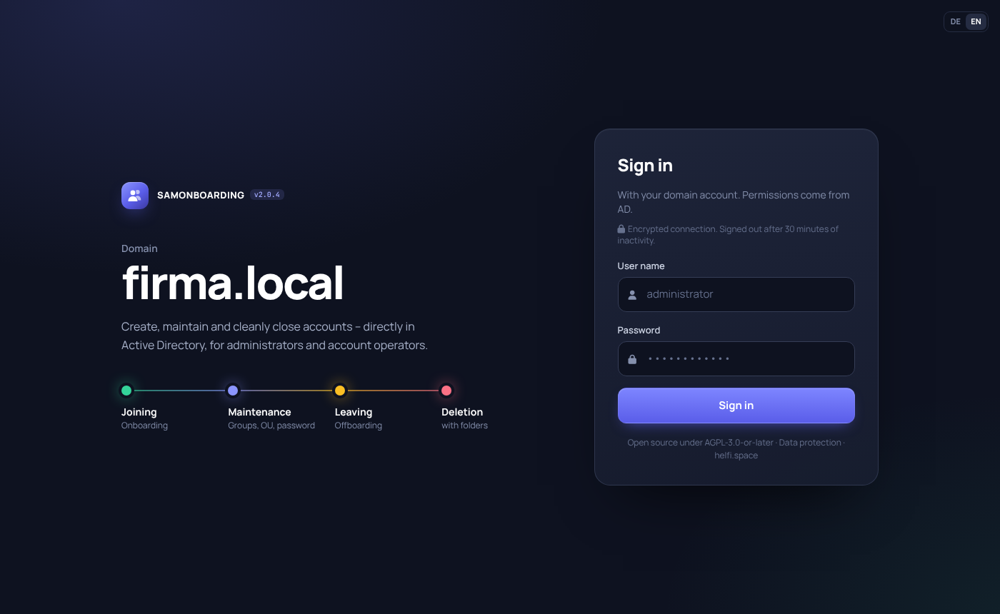
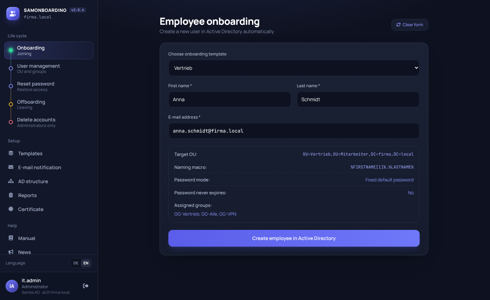
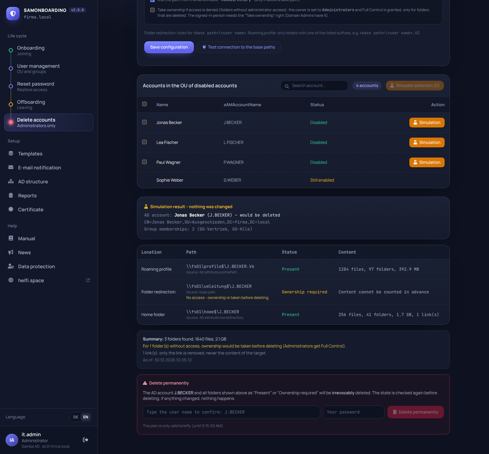

# SAMONBOARDING

*Deutsche Version: [README.de.md](README.de.md)* · **Manual: [MANUAL.en.md](samonboarding/web/manual/MANUAL.en.md)** · **Data protection (GDPR): [DATA-PROTECTION.md](DATA-PROTECTION.md)** · Website: [helfi.space](https://helfi.space) · License: [AGPL-3.0-or-later](LICENSE) · Changes: [CHANGELOG.md](CHANGELOG.md)

Web application for day-to-day user management in Active Directory (**Samba AD** or **Windows Server AD**):

| Module | What it does |
|---|---|
| **Onboarding** | Creates new users from a template (naming scheme, OU, password, groups, further attributes) |
| **Offboarding** | Disables an account, removes it from all groups and moves it to a target OU |
| **Password reset** | Resets passwords (random or manual), can unlock accounts and force a change at next logon |
| **User management** | Moves accounts between permitted OUs and maintains group memberships |
| **Restore** | Undoes an accidental offboarding (OU, groups, enabled state) |
| **Delete accounts** | Administrators only: deletes disabled accounts including roaming profile, folder redirection and home folder, always simulated first |
| **E-mail notification** | Optional: mail to the employee who performed the action (SMTP) |

The application runs as a Docker container (FastAPI + ldap3). The web interface is fully built in and needs no internet access. It is available in **English and German** (switch with *DE / EN*); German labels are given in *italics* in this document where they help.



> **Please read before use**
>
> - **Spare-time project, no warranty.** SAMONBOARDING was built for my own needs and is maintained in my spare time. There is no warranty and no liability (sections 15 and 16 of the [license](LICENSE)).
> - **The program has far-reaching rights.** It creates accounts, resets passwords and deletes accounts and folders. Try it in a **test environment** first and make a backup before using it in a real AD for the first time.
> - **Tested with Samba AD.** Windows Server AD is supported but less proven (for example several DCs, Exchange, large structures). Feedback on this is welcome.
> - **Fixed version for production.** `latest` is rebuilt, tested and scanned automatically every week, but not against a real AD. If you want to check changes yourself first, set a fixed version, for example `SAMONBOARDING_VERSION=2.0` in `.env` (see [Fixing a version and going back](#fixing-a-version-and-going-back)).
> - **No support.** Questions and bug reports are read but answered only as time allows. Please do not report **security vulnerabilities** publicly; see [SECURITY.md](SECURITY.md).

---

## Contents

1. [How it works](#1-how-it-works)
2. [Requirements](#2-requirements)
3. [Installation](#3-installation)
4. [Configuration](#4-configuration)
5. [Preparing Active Directory](#5-preparing-active-directory)
6. [First-time setup in the interface](#6-first-time-setup-in-the-interface)
7. [The modules in detail](#7-the-modules-in-detail)
8. [Operation](#8-operation)
9. [Security notes](#9-security-notes)
10. [Troubleshooting](#10-troubleshooting)
11. [Development](#11-development)

---

## 1. How it works

```
 Browser  ──HTTPS──▶  SAMONBOARDING (Docker, port 9500)  ──LDAPS 636──▶  Domain controller
                                   │
                                   └──SMTP (optional)──▶  Mail server
```

These five points explain the whole concept:

1. **There is no service account.** Everyone signs in with their *own* AD account, and every action runs as that user. Whatever AD does not allow them, they cannot do here either. Permissions are granted in AD (delegation), not in the application.
2. **The connection to the DC is encrypted (LDAPS, port 636).** This is required because AD only allows setting passwords over an encrypted connection.
3. **Two roles**, based on the groups of the signed-in user (nested memberships count):

   | Role | Requirement | Allowed to |
   |---|---|---|
   | **Administrator** | Member of `Administrators`, `Domain Admins` or `Enterprise Admins` (detected by SID, also with localized names) | everything, including settings, templates, SMTP and choosing the permitted OUs |
   | **Account Operator** | Member of `Account Operators` **or** of your own group (`CUSTOM_OPERATOR_GROUP`) | onboarding, offboarding, password reset and user management, but only in the OUs the administrator has permitted |

   Everyone else is rejected at sign-in.
4. **Permitted OUs.** In the interface, the administrator chooses in which OUs work may be done. The server checks this again on every action, not just the interface.
5. **HTTPS only, sessions in memory only.** The application is only available over HTTPS. Sessions (including the password, which is needed for the actions in AD) end on sign-out, after **30 minutes of inactivity** or when the container restarts. Every action is recorded in the **reports** (SQLite, without passwords).

### Interface

The navigation follows the life cycle of an account: **joining** (*Onboarding*), **maintenance** (*Benutzerverwaltung* = user management, *Passwort zurücksetzen* = password reset), **leaving** (*Offboarding*) and **deletion** (*Konten löschen*). Below that are setup (*Templates*, *E-Mail-Benachrichtigung*, *AD-Struktur*) and help. Feedback appears as a message in the bottom right corner. Errors and long messages stay until you close them. On tablets and phones the navigation opens from the menu icon in the top left.

**Language:** the interface is available in **German and English**. Switch with *DE / EN* at the bottom of the sidebar or in the top right corner of the sign-in page. The browser remembers the choice; on the first visit the browser language is used. Server messages and notification mails use the chosen language. Names, OUs, groups and paths from AD are never translated. The English texts are in `samonboarding/web/i18n.json` (German text → English text, with placeholders `{0}` for values).

Colours and fonts are defined in `samonboarding/web/theme.json`. After changing them a new image is built (see [section 11](#11-development)).

---

## 2. Requirements

- A Linux server, a VM or a NAS (e.g. **Synology** with *Container Manager*) with **Docker** and **Docker Compose** (`docker compose` or `docker-compose`)
- The server reaches the domain controller on **TCP 636** (LDAPS) and can resolve its name
- A **domain controller** with LDAPS enabled (see [section 5](#5-preparing-active-directory))
- Optional: an SMTP server for notifications

The program is completely in the image. Only three things live on the server:

```
/opt/samonboarding/          (any folder)
├── docker-compose.yml       ← from the release, do not edit
├── .env                     ← your settings
└── data/                    ← everything the program stores (Docker creates it on the first start)
    └── backups/             ← backups before every version change (created by the program)
```

---

## 3. Installation

### Step 1: Get the files

The files `docker-compose.yml` and `env.example` are attached to every release on GitHub (*Releases* → newest version → *Assets*). On the server:

```bash
sudo mkdir -p /opt/samonboarding && cd /opt/samonboarding
# put docker-compose.yml and env.example of the newest release here, then:
sudo cp env.example .env
```

If the repository is private, the image is private too. Then log in once (user = GitHub account, password = token with the right *read:packages*): `sudo docker login ghcr.io`.

### Step 2: Enter your settings in `.env`

Your settings are in the file **`.env`**, not in `docker-compose.yml`. The `.env` belongs to you and is never overwritten.

```bash
sudo nano .env
```

Adjust at least these values:

```ini
AD_DOMAIN=firma.local
AD_DC_IP=10.0.10.5
CUSTOM_OPERATOR_GROUP=CO-ADMIN
```

All other settings (version, port, time zone, certificate, retention …) are listed with comments in `.env`; their meaning is in [section 4](#4-configuration). Please write comments only on their own lines (starting with `#`), never after a value. A CA file for the DC (`LDAP_CA_FILE`) must be in the data folder, e.g. `data/ca.pem` (`/app/data/ca.pem` in the container).

If you need something that cannot be set in `.env` (e.g. your own DNS server for the container), create a **`docker-compose.override.yml`**. Docker reads it automatically in addition; it is never replaced.

### Step 3: Start

```bash
sudo docker compose up -d
```

Docker fetches the image and starts the container. On the first start it creates `data/`; the program hands the folder over to its own user (10001) and then runs without special rights. Nothing is built on the server.

### Step 4: Check

```bash
sudo docker compose ps          # status should be "healthy"
sudo docker compose logs -f     # follow the logs (Ctrl+C stops the display)
```

**No internet in operation:** the application does not open any connections to the internet by itself, only to the DC, file server, SMTP and, if used, Exchange (see [section 9](#9-security-notes)). To isolate the container further, restrict the outgoing traffic of the Docker network `samonboarding` (subnet `DOCKER_SUBNET`) in the firewall of the host, router or NAS. For updates without internet see [Without internet](#without-internet).

### Step 5: Sign in

Open `https://<server>:9500` in the browser and sign in with an AD account that is an administrator. On the first start the application creates a **self-signed certificate**, so the browser shows a warning once. Upload your own certificate afterwards in the interface under **Certificate** (see [HTTPS](#https)). These spellings are allowed:

- `username`
- `username@firma.local`
- `FIRMA\username`

Continue with the [first-time setup](#6-first-time-setup-in-the-interface).

### With a container manager (Dockhand, Portainer & co.)

Create a stack with the content of `docker-compose.yml` and enter the settings from `env.example` as `.env` or as variables of the stack. The data folder `./data` is then in the folder of the stack. For a private image, add the registry `ghcr.io` with a token with *read:packages*.

### Moving from version 1.x

Up to 1.48 the whole program was in the folder on the server (ZIP or `git clone`, partly built there). The move, step by step:

1. **Run the previous update script once:**
   ```bash
   cd /opt/samonboarding
   sudo sh update.sh --pull
   ```
   It fetches the new version, takes the new `update.sh` and the new `docker-compose.yml` from the image and starts the container. If it does not start, the previous version comes back. `.env` and `data/` stay as they are. A `SAMONBOARDING_IMAGE=…` in `.env` is taken over into `SAMONBOARDING_VERSION`.
2. **Check** that everything runs (`sudo docker compose ps`, sign in to the interface).
3. **Remove the old program files:**
   ```bash
   sudo sh update.sh --cleanup
   ```
   The script shows the list of files that are no longer needed (program folders, old ZIPs, version folders, temporary files, remains of the former internet block), asks and deletes only those. It **never** touches `data/`, `backups/`, `.env`, `docker-compose.yml` (also `.alt` and `docker-compose.override.yml`), `update.sh` and folders mounted by a container – not via links either.

Afterwards only `docker-compose.yml`, `.env`, `data/` (and the old backups in `backups/`) are left in the folder.

**Data so far in the Docker volume `samonboarding-data`** (Dockhand with the former `docker-compose.image.yml`): copy it once into the folder `data` next to the new `docker-compose.yml`, with the old stack stopped:

```bash
cd /opt/samonboarding     # folder with the new docker-compose.yml
sudo docker run --rm --user 0 --entrypoint sh -v samonboarding-data:/von:ro -v "$PWD/data":/nach \
  ghcr.io/soleil0815/samonboarding:latest -c 'cp -a /von/. /nach/'
sudo docker compose up -d
```

Once everything runs, the old volume can be deleted with `sudo docker volume rm samonboarding-data`.

## 4. Configuration

Whether the directory is a **Samba AD** or a **Windows Server AD** is detected automatically at sign-in (RootDSE) and shown next to the role. No setting is needed for this.

All settings are in the file **`.env`** (template: `env.example` in the release or `.env.example` in the repository). After a change run `docker compose up -d` (the container is recreated). An empty value means: default (exception `TZ`: empty means UTC).

| Variable | Default | Meaning |
|---|---|---|
| `AD_DOMAIN` | `firma.local` | DNS name of the domain (not the NetBIOS name). The search base is derived from it: `firma.local` → `DC=firma,DC=local` |
| `AD_DC_IP` | `10.0.10.5` | IP address or name of the domain controller |
| `CUSTOM_OPERATOR_GROUP` | empty | sAMAccountName of an additional group whose members are operators. The built-in *Account Operators* group always applies, recognised by its SID |
| `LDAP_CA_FILE` | empty | Path (inside the container) to a CA file in PEM format. If set, the DC certificate is verified |
| `LDAP_ALLOW_PLAIN` | `false` | `true` = fall back to unencrypted LDAP (port 389) if 636 is unreachable. Passwords then travel in plain text – emergencies only |
| `SESSION_IDLE_MINUTES` | `30` | Sign-out after this many minutes of inactivity |
| `SESSION_MAX_HOURS` | `12` | Maximum session length, even with continuous activity. Then sign in again (the role is determined again) |
| `HTTPS_PORT` | `9500` | HTTPS port in the container. There is no HTTP port |
| `TLS_HOSTNAMES` | empty | Names and IPs for the self-signed certificate, comma-separated (e.g. `samonboarding.firma.local,10.0.10.20`) |
| `TLS_CERT_FILE`, `TLS_KEY_FILE` | `data/tls/cert.pem`, `data/tls/key.pem` | Your own certificate and key (PEM) |
| `LOGIN_MAX_ATTEMPTS` | `5` | Failed attempts per user and IP before a temporary lock |
| `LOGIN_LOCK_MINUTES` | `5` | Duration of the lock in minutes |
| `DATA_DIR` | `<project>/data` | Data directory (inside the container `/app/data`) |
| `TZ` | `Europe/Berlin` | Time zone for reports and mails (e.g. `Europe/London`, `UTC`) |
| `DOCKER_SUBNET` | `172.30.80.0/24` | Subnet of the container's Docker network. Only change it if it overlaps with your network |
| `AUDIT_RETENTION_DAYS` | `365` | Data protection: older report entries (changes) are deleted daily. `0` = unlimited |
| `LOG_RETENTION_DAYS` | `90` | Data protection: older log entries are deleted daily. `0` = unlimited |
| `OFFBOARD_RETENTION_DAYS` | `180` | Data protection: restore entries are deleted this many days after offboarding. `0` = unlimited |

Notes:

- **Certificate validation:** By default the application trusts the DC's LDAPS certificate automatically, including a self-signed one (Samba) or one from your own company CA. Nothing has to be imported. The connection is still encrypted, but without the check someone on the network could pose as the DC and read the passwords of people signing in (man-in-the-middle). Setting `LDAP_CA_FILE` is therefore **recommended** (see [section 5](#5-preparing-active-directory)). `AD_DC_IP` must then be the name contained in the certificate.
- **Name resolution:** If you use a name instead of an IP for `AD_DC_IP`, the Docker host must be able to resolve it. If it cannot, add the AD DNS server to a `docker-compose.override.yml` (kept on updates):

  ```yaml
  services:
    samonboarding:
      dns:
        - 10.0.10.5
  ```
- If a file `data/config.json` exists, **it takes precedence** over the environment variables `AD_DOMAIN` and `AD_DC_IP`. The application does not create this file itself.

---

## 5. Preparing Active Directory

Preparation always consists of the same three things:

1. **LDAPS** on the domain controller (port 636)
2. Optional: an **operator group** (`CUSTOM_OPERATOR_GROUP`)
3. **Permissions** for the operators on the affected OUs

Test whether LDAPS is reachable (from the Docker host):

```bash
openssl s_client -connect 10.0.10.5:636 -showcerts </dev/null
```

If a certificate is shown, LDAPS is active. `connection refused` or a timeout means port 636 is closed or blocked.

### 5.1 Samba AD

**LDAPS:** Samba enables TLS by default and creates a self-signed certificate during provisioning. It usually lives in `/var/lib/samba/private/tls/` (`ca.pem`, `cert.pem`, `key.pem`; the path may differ depending on the installation). That is enough to get started. A test with `openssl s_client` should show a certificate.

**Create an operator group (optional):**

```bash
samba-tool group add CO-ADMIN
samba-tool group addmembers CO-ADMIN user1,user2
samba-tool group listmembers CO-ADMIN
```

The group name is the `sAMAccountName` and goes into `CUSTOM_OPERATOR_GROUP` in `.env`. Alternatively, operators can be members of the built-in group `Account Operators`:

```bash
samba-tool group addmembers "Account Operators" user1
```

**Permissions:** The built-in group `Account Operators` normally has permissions to manage users and groups. If you use your own group (`CO-ADMIN`), it needs these permissions on the OUs you work with. This can be done with `samba-tool dsacl set` or from a Windows client with RSAT (see the Samba documentation). The easiest way is to keep operators in `Account Operators`.

**Password policy:** Reset and new passwords must meet the policy. Show it with:

```bash
samba-tool domain passwordsettings show
```

**Enable certificate validation (optional):**

1. Copy `ca.pem` from the DC to `./data/ca.pem`
2. In `.env`: `LDAP_CA_FILE=/app/data/ca.pem` and set `AD_DC_IP` to the DNS name of the DC (for example `dc1.firma.local`)
3. `openssl x509 -in cert.pem -noout -subject -ext subjectAltName` shows which name the certificate contains

### 5.2 Windows Server AD

**LDAPS:** The domain controller needs a certificate with the purpose *Server Authentication* that contains the DC's DNS name. The easiest way is an **Active Directory Certificate Services (AD CS)** enterprise CA: domain controllers then receive a suitable certificate automatically, and LDAPS is available on port 636. Without a CA you can issue a certificate manually and install it in the DC's computer certificate store (Personal).

Test on the DC or a domain member server:

```powershell
Test-NetConnection dc1.firma.local -Port 636
```

Or with `ldp.exe`: *Connection → Connect…*, port `636`, tick *SSL*.

**Create an operator group (optional):**

```powershell
New-ADGroup -Name "CO-ADMIN" -GroupScope Global -GroupCategory Security -Path "OU=Groups,DC=firma,DC=local"
Add-ADGroupMember -Identity "CO-ADMIN" -Members user1,user2
```

**Delegate permissions** (for `CO-ADMIN` or any other own group): in *Active Directory Users and Computers*, right-click the OU → *Delegate Control…* and select these tasks:

| Task | Used for |
|---|---|
| Create, delete, and manage user accounts | Onboarding, offboarding (disable, move) |
| Reset user passwords and force password change at next logon | Password reset, unlock |
| Read all user information | Showing the user lists |
| Modify the membership of a group | Groups during onboarding, offboarding and in user management |

Important:

- Permissions apply **per OU**. Delegate them for all source OUs, target OUs and group OUs you permit later in the interface. To move an account the operator needs the right to create objects in the target OU.
- The built-in group `Account Operators` has such rights by default, but **not** for protected accounts (for example members of `Domain Admins`).

**Enable certificate validation (optional):**

1. Export the CA root certificate (format *Base-64 encoded X.509*) and save it as `./data/ca.pem`
2. In `.env`: `LDAP_CA_FILE=/app/data/ca.pem` and set `AD_DC_IP` to the **fully qualified DNS name** of the DC (for example `dc1.firma.local`) as contained in the certificate
3. The Docker host must be able to resolve this name (see the note on `dns:` in [section 4](#4-configuration))

---

## 6. First-time setup in the interface

Sign in as an **administrator**. The settings are found in each menu item in a box marked *„(Nur Admin)"* (administrators only).

1. Open *AD-Struktur* (AD structure): OUs and groups must be listed here. If the list is empty, the connection is not working (see [troubleshooting](#10-troubleshooting)).
2. **Offboarding:** choose the source OUs (accounts there may be offboarded) and the target OU for disabled accounts. Save.
3. *Passwort zurücksetzen* (password reset): choose the source OUs in which passwords may be reset. Save.
4. *Benutzerverwaltung* (user management): choose source OUs (scan area), permitted target OUs (moving) and group OUs (group selection). Save.
5. **Templates:** create at least one template for onboarding (see below).
6. *E-Mail-Benachrichtigung* (optional): enter the SMTP server, save and send a test mail with the test button.
7. **Test as an operator:** sign in with an operator account and run one onboarding, one password reset and one offboarding with a test user.

Using the selection: OUs and groups appear as a **tree with checkboxes**. The arrows expand and collapse branches, the search box filters. For **source OUs and group OUs** a selected OU applies **including all sub-OUs**. For **permitted target OUs** exactly the selected OU applies.

As long as no source OUs are chosen for a module, its list stays empty and a note says that no OUs are configured.

### Templates

A template describes how a new user is created:

| Field | Meaning |
|---|---|
| *Template Name* | Name of the template (required) |
| *Username Makro* | Structure of the user name (`sAMAccountName`), see table below |
| *Ziel OU (DN)* | OU in which the account is created (enter a DN or pick from the AD list) |
| *E-Mail-Adresse / Postfach* | Whether the e-mail address is required, optional or not asked, and whether an Exchange mailbox is created (see [below](#e-mail-address-and-mailbox-per-template)) |
| *Passwort-Modus* | *Automatic random password* (12 characters, without easily confused characters such as 0/O or 1/l/I) or *fixed default password* (then the field *Standardpasswort* must be filled) |
| *Benutzer muss Passwort beim nächsten Login ändern* | Forces a change at first logon |
| *Kennwort läuft nie ab* | Sets the "password never expires" flag |
| *AD Gruppen zuweisen* | Groups the user is added to (tree with checkboxes) |
| Further fields | Optional: display name, department, company, job title, manager (manager DN), office, phone, address, country and more |
| Profile (like the RSAT tab "Profile") | **Profile path**, **logon script** and **home folder** (see below) |

**Home folder** as in RSAT: *Local path* (path only, e.g. `C:\Users\%username%`) or *Connect* with a drive letter (`D:` to `Z:`, default `Z:`) and network path (`\\server\home$\%username%`). A drive letter requires a network path; the application checks this when saving. By default only the AD attributes are set (`homeDirectory`, `homeDrive`). With the option to **create the folder automatically when the user is created**, the application also creates the folder itself (see [Creating the home folder automatically](#creating-the-home-folder-automatically)). Profile path, logon script and home folder are limited to 260 characters (AD limit).

Text fields may contain the placeholder `%username%`. It is replaced by the new user name, for example for the path `\\server\home\%username%`.

**Naming macros** (examples):

| Macro | Name | Result |
|---|---|---|
| `%LASTNAME%%FIRSTNAME%[3]` (default) | Max Mustermann | `MUSTERMANNMAX` |
| `%FIRSTNAME[1]%.%LASTNAME%` | Anna Schmidt | `A.SCHMIDT` |
| `%LASTNAME[5]%%FIRSTNAME[2]%` | Eva Öztürk | `OEZTUEV` |

- `%FIRSTNAME%` and `%LASTNAME%` stand for first and last name; `[n]` uses only the first *n* characters
- The name is built in upper case, umlauts are transliterated (Ä → AE, ß → SS), accents are dropped, spaces and hyphens are removed
- Only `A–Z`, `0–9`, `.`, `_`, `-` are allowed, **at most 20 characters**
- If the name is already taken, a number is appended (`…2`, `…3`)

---

## 7. The modules in detail

### Onboarding



1. Choose a template, enter first and last name and (depending on the template) the e-mail address
2. The account is created in the template's target OU (name: *First Last*, UPN: `username@firma.local`)
3. The account is first created **disabled**, then the password is set, then it is enabled. If setting the password fails, the half-finished account is deleted again
4. The template's groups are assigned. If this fails for individual groups, a warning is shown
5. The credentials appear in the result window (copy or print as PDF). If SMTP is active, a mail goes to the employee who performed the action

#### E-mail address and mailbox per template

In a template's dialog (menu item **Templates**) the administrator chooses under *E-Mail-Adresse / Postfach* what happens during onboarding with this template. Templates for different environments can therefore coexist:

| Setting | When it makes sense | Behaviour |
|---|---|---|
| **Own mail server without Exchange** (default) | The address must be stored in AD | Required field, no account without an address |
| **E-mail address optional** | Mixed environment | Field present, may stay empty |
| **On-premises Exchange** | The mailbox should be created automatically | Field hidden, the mailbox is created via Exchange (see next section) |
| **Microsoft 365 / Exchange Online** | The mailbox is created through the licence | Field hidden, the `mail` attribute is not set |

During onboarding the form follows the selected template: switching the template shows or hides the e-mail field accordingly. The server enforces the setting as well (with *Exchange* and *Microsoft 365* a submitted address is ignored). If no address was set, the e-mail line is omitted in the mail and the result window.

The dialog also shows a **hint** read from AD: an entry *Microsoft Exchange* in the configuration partition indicates Exchange, an account `MSOL_*` or `AAD_*` indicates Microsoft Entra Connect (Azure synchronisation). This is only a recommendation; a pure cloud environment does not have to leave traces in AD.

**Older templates** without this setting remain *required*. If the global setting *do not ask* was chosen in version 1.15, templates without their own value inherit it as *Microsoft 365* until they are saved once.

**Microsoft 365:** the application does not create a mailbox there. It is created when a licence is assigned to the user. This can be automated: add the group that assigns the licence via *group-based licensing* to the template. After the next synchronisation (usually about 30 minutes) the mailbox exists.

#### Creating a mailbox on an on-premises Exchange server

For templates set to *On-premises Exchange*, the application runs `Enable-Mailbox` on your Exchange server after creating the account. The connection is set up once in the menu item **Templates**, box *Exchange im eigenen Haus* (on-premises Exchange):

| Field | Meaning |
|---|---|
| Enable Exchange integration | Switch, **off** by default. While it is off, a template with *On-premises Exchange* only gets a warning and no mailbox is created |
| Exchange server | Server name without `https://` (e.g. `exchange01.firma.local`), reachable from the container |
| Port, HTTPS, verify certificate | Default `443`, HTTPS on, verification on. Only turn verification off if the certificate cannot be trusted otherwise |
| Authentication | *Automatic (negotiate)*; if there are problems try *NTLM* or *Kerberos* |
| Mailbox database | empty = Exchange chooses |
| Domain controller | empty = the same DC the application used to create the account, so Exchange does not have to wait for replication |

Process and rules:

- The application connects to `https://<server>/PowerShell` (Exchange Management Shell) using the **credentials of the signed-in user**. That user needs the Exchange role *Mail Recipients* (e.g. through the role group *Recipient Management*). No Exchange credentials are stored
- **Test connection** checks reachability, authentication and whether `Enable-Mailbox` is available to the account, using the values in the form (even unsaved)
- If no mailbox is created (error, server unreachable), the **account remains**. A warning is shown and the mailbox can be created in Exchange later. Nothing is rolled back
- Exchange assigns the e-mail address according to its address policy. The application then reads it from AD and shows it in the result. The form does not ask for it with this template
- Creating the mailbox can take a few seconds; do not close the page meanwhile
- This uses the Python package `pypsrp` (in `requirements.txt`). If it is missing, the test reports it
- Every change of the setting and every connection test is recorded in the reports, without passwords

This feature can only be fully verified against a real Exchange server. Try it with a test account first.

#### Creating the home folder automatically

If a network path is entered as home folder in the template and the option to create the folder automatically is set, the following happens after the account has been created:

1. The application creates **only the last folder** of the path. The parent folder (e.g. `\\server\home$`) must exist
2. The new account gets **Full Control** (inherited by subfolders and files). All other permissions, including those inherited from the parent folder, stay unchanged. Afterwards the application reads back whether the entry really is set
3. If the folder already exists, it is **not touched** (it might belong to someone else). A note is shown
4. The folder is created with the credentials of the signed-in person, who needs the right to create folders and change permissions on the server
5. An error (server unreachable, missing right) **never** prevents creating the account. It appears as a note in the result window and in the reports (`homeFolder`)

As with deletion, the container must reach the file server on TCP 445. If the folder has no permission list at all (rare, "Everyone has access"), it is not changed.

### Offboarding

Choose an account from the source OUs. It is **disabled**, **removed from all groups** and moved to the **target OU**. Your own account cannot be offboarded.

**Multi-selection:** with the checkboxes up to 25 accounts can be offboarded at once (header checkbox = all visible). Before starting, a confirmation shows the number and the names. The accounts are processed one after another; an error with one account (e.g. protected, outside the source OU) does not stop the others. At the end you see what worked and what did not. Every account has its own audit entry; the notification mail is a single summary.

**Protected accounts:** privileged accounts are always rejected by the server (*403*), for all roles. Privileged means members (also through nested groups or as primary group) of *Domain Admins*, *Schema Admins*, *Enterprise Admins* and the built-in groups *Administrators*, *Account/Server/Print/Backup Operators*, as well as the built-in Administrator account (RID 500) and `krbtgt`. In the list such accounts are shown with a lock and cannot be selected. The check reads each account's real groups (`tokenGroups`) and not only the `adminCount` flag, which not every directory maintains. It is checked again when the action runs. If such an account really has to be processed, remove the membership in AD first.

**Restore (undo offboarding):** before every offboarding the application records the OU the account was in, its groups and whether it was enabled. Under *Offgeboardete Konten wiederherstellen* (bottom of the offboarding page) every account offboarded this way is listed with a **Restore** button (*Wiederherstellen*):

1. A **preview** shows what will happen: back to the OU, back into these groups, enabled again. Nothing is changed by the preview
2. If the old OU no longer exists or is no longer within the offboarding source OUs, you choose another OU from the list
3. After **Restore** the account is moved, added back to its groups and enabled. Offboarding did not change the password, so it still works

Account and groups are looked up by their fixed AD identifier (`objectGUID`), even if they have been renamed or moved in the meantime. A deleted group is skipped (note), a group without write permission is reported individually, and everything else is still restored. An account that was already disabled before offboarding stays disabled.

Anyone allowed to offboard may restore. Administrators can additionally **discard** an entry (e.g. if the account was restored by hand). An entry disappears once the account has been restored, deleted or discarded. The data is stored in `data/offboarding.db` (SQLite, no additional software needed), without passwords. Accounts offboarded before version 1.19 have no entry. Every restore is recorded in the reports (`offboarding-restore`); if offboarding mails are enabled, a notification is sent.

### Password reset

Choose an account from the permitted OUs, then *random password* (12 characters) or *manual* (at least 6 characters; the AD password policy applies). Optional: force a change at next logon and unlock the account. The new password is shown once in the result window.

### User management

- **Move:** move the account to one of the permitted target OUs
- **Groups:** add or remove group memberships from the permitted group OUs

All user lists are sorted alphabetically by display name.

### Delete accounts (administrators only)



The menu item *Konten löschen* is only visible to administrators. Account Operators do not see it, and the server additionally rejects their requests with *403*. Protected (privileged) accounts, see offboarding, can neither be simulated nor deleted here.

**Setup (configuration on the page, administrators only):**

1. Choose the **OU of the disabled accounts** (pre-filled with the offboarding target OU). Only accounts in this OU that are also disabled appear in the list.
2. For every storage location you use, tick it and enter the **base paths** as UNC paths (one per line). **Storage locations are optional:** if your domain has no profiles, home folders or folder redirection on servers, leave all of them unticked. The application then only deletes the AD account and does not access any files (and `smbprotocol` is not needed for that). Simulation, password confirmation and all protections still apply. An enabled storage location needs at least one base path:

   | Storage location | Looked for | Notes |
   |---|---|---|
   | Roaming profile | `<base path>\<user name>.V2` | Only folders with one of the configured **suffixes** (`V2`, `V6`, …). Without a matching suffix nothing is suggested |
   | Folder redirection | `<base path>\<user name>` | Not stored in an account attribute but in the GPO, hence the fixed base path |
   | Home folder | `<base path>\<user name>` | Additionally the path from the account's `homeDirectory` |

   For profile and home folder the path from the AD account (`profilePath`, `homeDirectory`) can be used too. It only counts if it is **below a base path**. `%username%` is replaced, other variables are rejected.
3. Optional per storage location: **take ownership if access is denied** (see below)
4. Save, then **test the connection to the base paths**. The test reports for each base path whether the server is reachable and the content readable.

**Simulation:** click *Simulation* in the list. It shows the AD account (name, DN, number of groups) and for each path the status, source, number of files and folders and the size. The simulation changes nothing.

**Delete:** if the simulation looks right, the field *Endgültig löschen* (delete permanently) appears below it. To confirm, type the user name, enter your **own password** and confirm the dialog. The password is compared with that of the current session. A wrong password does not use up the plan. After 5 failed attempts deletion is locked for this session for about 5 minutes; every failed attempt is recorded in the reports (`deletion-password-fail`, without the password). Process:

1. The plan from the simulation is valid for **10 minutes**, only for this session and this account, and only **once**
2. Everything is **checked again** before deleting. If anything changed since the simulation (new folder, access revoked, account enabled again), nothing happens and the simulation must be repeated
3. First the **folders** are deleted (files first, then folders from the inside out), then the **AD account**
4. If something fails for a folder (e.g. a locked file, see troubleshooting), the **AD account remains**. The result list shows per folder what was deleted and what was not. After fixing the cause, repeat the simulation; only the rest will be found
5. Every deletion is recorded with all folders and numbers in the reports (`deletion-execute`)

**Several accounts at once:** tick accounts in the list (or *all visible* at the top, at most **25 per run**) and click *Auswahl simulieren* (simulate selection).

- The **batch simulation** is read-only. Every account appears as *ready* or *blocked* (with reason, e.g. still enabled, no access, shared folder); the paths can be expanded. Blocked accounts are never deleted
- To confirm, type the **number** of ready accounts and enter your own **password**. The number catches accidental triggering, the password makes sure it really is you
- Deletion runs as a **background job** with a progress display. The page may stay open, but the job also continues on the server without it
- Every account goes through the same process as a single deletion (re-check, folders first, then the AD account). If one fails, it remains and the others continue. A table shows the result per account at the end
- The reports contain one entry per account (`deletion-execute`) and a summary entry (`deletion-batch`). The deletion mail is **one summary** per run
- The simulation runs sequentially in one request. With 25 very large profiles this can take a while. If requests go through a reverse proxy, choose a generous timeout
- If the container is restarted during a job, the job ends there. Accounts already deleted are in the reports; the rest remains and can be simulated again

**Taking ownership (optional, per storage location):** Windows often creates profile folders so that only the user has access. Instead of changing permissions on the server by hand, the application can do it. If the option is enabled for a storage location:

- The **simulation** only checks whether ownership could be taken (handle with the right *change owner*) and changes nothing. Affected folders show the status *ownership required*. Their content cannot be counted beforehand, so the numbers are minimums
- During **deletion**, only for an entry that fails with *access denied*, the owner is set to `Administrators` and this group gets Full Control. Then it is retried **once**. Only folders and files that are deleted anyway are touched
- Every takeover is counted: in the result ("ownership taken: n×") and in the reports (`takeovers`, `takeoverPaths`)
- The signed-in administrator needs the Windows right *Take ownership of files or other objects* on the file server (Domain Admins and local administrators have it by default). Without it the folder remains an obstacle and the simulation reports *no access*
- Without the option everything works as described: missing access prevents deletion

Deletion is **permanent, without a recycle bin**. The AD account can only be recovered via the AD Recycle Bin (if enabled), the files only from a backup or the file server's shadow copies. With very large profiles deletion can take a few minutes; do not close the page meanwhile.

**Protections:**

- Only paths **below** the configured base paths are considered. The base path itself and the share are never a target
- Rejected: `..`, wildcards (`* ?`), `:` (streams), `%`, a trailing dot or space, and paths not starting with `\\`
- If the same path is also set in AD for **other accounts** (e.g. a shared department folder as home folder), it is excluded
- Links (junctions, symlinks) are **never followed**: only the link itself is removed, the content of the target is untouched. The simulation shows how many links are contained. If the target folder itself is a link, it is skipped
- The SMB library deletes read-only files by removing the attribute first
- Your own account and accounts that are still enabled are rejected
- Every simulation, every deletion and every settings change is recorded in the reports

**Network requirements:**

- The container reaches the file servers on **TCP 445** (SMB)
- The signed-in administrator needs **read and delete permissions** on the folders. The file server decides; the application does not bypass anything. Windows often creates profile folders so that only the user has access. The GPO *"Add the Administrators security group to roaming user profiles"* or a suitable permission on the share helps here. Without access the simulation reports *no access*
- **Mail after deletion** (SMTP setting *Löschen eines Kontos*) can be switched off and stays off until you enable it. The mail goes to the signed-in person and lists account, result, folders, number of files and ownership takeovers. It is also sent if deletion was incomplete. It contains no passwords
- **No Samba server is needed in the container.** The application only uses an SMB client (Python package `smbprotocol`, included in `requirements.txt`)
- Authentication to the file server uses NTLM with the administrator's credentials. The file server should be reachable by name or IP and support SMB signing

---

## 8. Operation

### Account lists and cache

The interface only loads the page that is open. The server keeps the account lists per session for up to **60 seconds in memory** (`samonboarding/listcache.py`); every change clears them immediately; **Refresh accounts** / **Reload** always reads fresh (`?frisch=1`). There is deliberately **no copy of the AD accounts in a database**: everyone only sees what their own AD permissions allow, nothing is written to disk, and decisions such as *protected?* or *in the released OU?* are checked live on the DC before every action. The protection check for the list needs a few combined queries instead of one query per account.

### Renamed or moved OUs and groups

Settings and templates store OUs and groups as DNs. For every reference the application remembers the objectGUID (`data/verweise.json`). If an OU/group is renamed, moved or deleted in AD, administrators see a notice at the top; **Apply new names** updates all affected settings (recorded in the reports as `config-references`). Deleted objects must be replaced by hand. Roles depend on SIDs, restoring after offboarding on GUIDs – neither is affected by renames. Details: manual, section *Initial setup*.

### Reports and log

Everything is written to **`data/reports.db`** (SQLite), without passwords. Administrators see it in the interface under **Reports**:

| Section | Content | Deleted automatically after |
|---|---|---|
| **Changes** | Who did what and when: sign-in, onboarding, offboarding, password reset, groups, deletion, settings, with result and details | 365 days (`AUDIT_RETENTION_DAYS`) |
| **Log** | Program messages from level *Info* upwards (e.g. connection errors, warnings) | 90 days (`LOG_RETENTION_DAYS`) |

- Search, filters (successful/failed, or warnings/errors) and *Load more* for older entries
- **Delete manually:** at the bottom of the page choose "older than 30/90/180 days" or "all entries" and confirm with your own password. The deletion itself is recorded in the changes
- Deleted entries are overwritten in the database file (`secure_delete`) and cannot be recovered
- An existing `audit.log` from older versions is imported on first start and then removed

The container output (`docker compose logs -f`) is still available, limited to 3 × 10 MB. Individual browser requests (IP addresses) are not logged.

Subject access request (Art. 15 GDPR), i.e. everything the application has stored about an account: in the interface under *Data protection*, or with

```bash
docker compose exec samonboarding python -m samonboarding.privacy auskunft jdoe
```

### Update

**With a container manager** (Dockhand, Watchtower, Tugtainer, Portainer …): simply enable automatic updates. Recommendation: **at night**, e.g. at 3 am. Before a version change the program backs up `data/` itself when it starts (see below); if a version does not start, it stays "unhealthy" and the container manager reports it.

**By hand:**

```bash
cd /opt/samonboarding
sudo docker compose pull && sudo docker compose up -d
```

**With the helper script** (remembers the running version and goes back if the start fails):

```bash
sudo sh update.sh
```

`update.sh` is in the image and arrives in the folder automatically when moving from 1.x; to get it again: `sudo docker run --rm --entrypoint cat ghcr.io/soleil0815/samonboarding:latest /app/update.sh > update.sh`. It runs with `/bin/sh` (also dash and on a NAS) and only does this:

1. remember the running version as the image `samonboarding:previous`
2. fetch the wanted version (default: the one in `.env`, empty = `latest`)
3. `docker compose up -d` and wait for the health check
4. if the new version does not start: ask and start the previous one again (with `-y` without asking)

If the image brings a newer `docker-compose.yml`, the script puts it in place and keeps the old one as `docker-compose.yml.alt`. It does not unpack ZIPs, does not place program files and builds nothing.

| Call | Effect |
|---|---|
| `sudo sh update.sh` | Update to the version in `.env` (empty = `latest`) |
| `sudo sh update.sh --version 2.0` | Set a version (written to `.env`) and fetch it |
| `sudo sh update.sh --latest` | Back to the newest version (entry in `.env` emptied) |
| `sudo sh update.sh --offline <file>` | Load an image file from the release and start (without internet) |
| `sudo sh update.sh --restore data/backups/<file>` | Put a backup of `data/` back (the current state is saved first) |
| `sudo sh update.sh --cleanup` | Remove files of older installations that are no longer needed |
| `-y` | Answer questions with yes |

Only settings in `.env` changed: `sudo docker compose up -d` is enough. All users are signed out after a restart.

**If the `docker-compose.yml` is too old**, the interface shows administrators a note. Remedy: `sudo sh update.sh` (replaces it automatically) or get the `docker-compose.yml` of the current release and run `sudo docker compose up -d`.

### What happens on a version change

When a different program version starts than last time, the program **first** backs up the data folder to `data/backups/vor-<version>-<date>.tar.gz` (the last 10 are kept) and then brings the data to the state of the new version (`data/datenstand.json`). Security updates (`-s1`, `-s2` …) are the same program and need no backup.

If an **older** version starts on data that a newer version has already converted, it stops with a clear message (in `docker compose logs`) instead of running on with follow-up errors. The message names the matching backup.

### Fixing a version and going back

In `.env`:

| `SAMONBOARDING_VERSION=` | Meaning |
|---|---|
| *(empty)* | always the newest version (`latest`) |
| `2.0` | the newest 2.0.x including security updates, no jump to 2.1 or 3.0 |
| `2.0.1` | exactly this version (its security updates are `2.0.1-s1`, `2.0.1-s2` …) |

Then `sudo docker compose pull && sudo docker compose up -d` (or `sudo sh update.sh --version 2.0`).

**Back to an older version:** if the newer version did not change the data format, it is enough to enter the older version and restart. If it did, the older one does not start and names the backup. Then:

```bash
sudo sh update.sh --restore data/backups/vor-2.1.0-20261102-030000.tar.gz --version 2.0.1
```

The script stops the container, saves the current state (`vor-wiederherstellen-<date>.tar.gz`), puts the backup back, sets the version and starts. Whatever was changed since that backup (settings, reports) is missing afterwards.

### Without internet

Every release has the image files `samonboarding-<version>-amd64.tar.gz` and `…-arm64.tar.gz` attached. Copy the matching file to the server (Intel/AMD: `amd64`, ARM NAS: `arm64`), then:

```bash
sudo sh update.sh --offline samonboarding-2.0.1-amd64.tar.gz
```

Without the script: `sudo docker load -i samonboarding-2.0.1-amd64.tar.gz`, `SAMONBOARDING_VERSION=2.0.1` in `.env`, `sudo docker compose up -d`.

### Reproducible versions

Every build uses exactly the same versions. The same files give the same image:

| File | Content |
|---|---|
| `images.lock` | Base images with a fixed version **and** checksum (`python:3.13.x-slim-trixie@sha256:…`, `node:24.x.y-trixie-slim@sha256:…`) plus `DEBIAN_SNAPSHOT`: the state of snapshot.debian.org from which all Debian packages of the image are installed |
| `os-packages.lock` | All Debian packages in the finished image with their version, per architecture (amd64, arm64). Every build is compared with it; if anything differs, nothing is published |
| `requirements.txt` | All Python packages including indirect ones, each `==version`. Installed with `--no-deps`; `pip check` then verifies that everything fits together |
| `requirements.in` | The direct Python packages with their outer limits |
| `package.json`, `package-lock.json` | npm packages for CSS, fonts and icons, exact and with checksums of all sub-packages (`npm ci`). Only needed while building, not part of the image |
| `requirements-dev.txt` | Test tools (pytest, ruff, pyright) with exact versions |

The versions are renewed with `python3 scripts/pins.py update` (needs Docker and internet). On GitHub this happens automatically every week (see *Automatic security updates*). Nothing is ever pinned or built on a server. The same limits always apply:

- same Debian version (`trixie`), same Python series (3.13) and Node series (24)
- every package within its major version, below 1.0 within its minor version (`0.54.x` stays `0.54`)
- calendar versions without a limit, e.g. root certificates (`certifi`) or time zone data (`tzdata`)

A new base (e.g. Debian 14 or Python 3.14) is never chosen automatically. For that the tags in `images.lock` are changed deliberately by hand and then checked as usual.

### Automatic security updates

Two workflows run on GitHub. A new program version only comes via a pull request; a pull request or a merge only checks, publishing is done by hand.

| When | What happens |
|---|---|
| Pull request, push to `main` | Build with exactly the pinned versions, tests in the image (amd64 and arm64), HTTPS start check (also started as with the `docker-compose.yml`), Trivy. Nothing is published |
| By hand: *Actions → Image → Run workflow → release* (on `main`) | The same checks, then published as `:<version>`, e.g. `:2.0.0`, plus `:2.0` and `:latest` if it is the highest in each case. A version that is already published is never overwritten. Release page with `docker-compose.yml`, `env.example` and the image files for servers without internet |
| Mondays 05:17 UTC (also by hand: *Actions → Image → Run workflow*) | Security update: renew the versions within the limits, build without cache, the same tests and Trivy. Only if everything passed: the new versions and a changelog entry (with the list of changed packages) are committed, and the image appears as `:<version>-s<counter>`, e.g. `:2.0.0-s1`, `:2.0.0-s2` (and as `:2.0` and `:latest` if it is the highest). A new program version starts again at `-s1`. If nothing changed, nothing happens |
| Every day 03:43 UTC | Trivy scans the published image `:latest`, so vulnerabilities that only become known after the release are noticed |
| Mondays 06:29 UTC | How long do Debian, Python and Node still get security updates (endoflife.date)? From 12 months before the end a note on the run, from 6 months a red run |

For every published version a release page `v<version>` with the changelog entry is created on GitHub (for security updates with the list of changed packages). `-s<counter>` means: same program, only newer packages. `:latest` always points to the highest version. An update reaches a server via the container manager, `docker compose pull` or `sudo sh update.sh` (see [Update](#update)).

Trivy is not included as a GitHub Action (`trivy-action` and `setup-trivy` were compromised in March 2026, CVE-2026-33634). `scripts/install-trivy.sh` downloads a fixed version and checks its SHA-256 checksum against the stored value and against the official checksums file of the release. A new Trivy version is only taken over deliberately, with version and checksum in that file.

**If a run is red:** GitHub sends an e-mail, nothing is published, and the last published image stays unchanged. The cause is shown briefly on the run (*Actions* → open the run → *Annotations* at the top):

| Message | Meaning | What to do |
|---|---|---|
| *Trivy found … vulnerabilities* | HIGH/CRITICAL vulnerability for which a fix exists | Usually the fix has not reached the Debian or package state yet: repeat the run by hand in a day or two. If the fix is outside the limits (e.g. only in a new major version), a deliberate program version is needed. If the finding is checked and cannot be exploited in the program: entry in `.trivyignore` with a reason and an expiry date |
| *Limits violated* | A version would leave its series | Nothing is taken over. Check whether the jump is wanted; if so, deliberately as a new program version |
| *Tests in the image … failed* / *does not answer on HTTPS* | A new package does not work with the program | The log of the step shows the failed test. The old versions stay in force; fix the program or `requirements.in` |
| *not reproducible* | A build gives other Debian packages than `os-packages.lock` | Usually an incomplete change to `images.lock`; start the security update by hand, it writes both files again |
| *Trivy download* | Trivy checksum does not match | Do not use anything. Compare version and checksum in `scripts/install-trivy.sh` with the official release |
| *security updates end on …* | The base runs out soon | Plan the change: new tags in `images.lock` (e.g. the next Python series), test, publish as a new program version |
| *… not reachable* / timeout | Docker Hub, snapshot.debian.org or endoflife.date could not be reached | Repeat the run later (*Re-run jobs*) |

### Backup

Back up the `data/` folder (together with `.env`). It contains everything the program stores:

- `config.json`, `smtp_config.json`, `templates.json` and the module configurations
- `offboarding.db` (stored states for restoring after offboarding)
- `reports.db` (reports: changes and log)
- `tls/` (HTTPS certificate and key)
- `datenstand.json` (data state and the program version used last)
- `backups/` (backups the program makes itself before every version change; the last 10 are kept)

The backups in `data/backups` are for going back to an older version. They do not help if the server is lost: `data/` also belongs in your normal backup.

### HTTPS

The application speaks **HTTPS only** (port 9500). There is no unencrypted port; requests without HTTPS are rejected. TLS 1.2 and 1.3 with modern ciphers are allowed. The session cookie is `Secure`, `HttpOnly` and `SameSite=Strict` and ends when the browser closes.

**Certificate:**

1. **Without your own certificate**, the application creates a self-signed one (valid for 10 years) in `data/tls/` on first start. The browser warns once. To get the right name into the certificate, set `TLS_HOSTNAMES` in `.env`, or create a new self-signed certificate with the right names in the interface under **Certificate**.
2. **Your own certificate** (e.g. from your internal CA, recommended): upload it in the interface under **Setup → Certificate** (administrators only). It takes effect **immediately, without a restart**. New connections get the new certificate; reload the page once.
   - **PFX/P12** with password, e.g. from the Windows certificate manager (*Export → Yes, export the private key*). Intermediate certificates are included.
   - **Certificate + key** as PEM or DER (`.pem`, `.crt`, `.cer`, `.key`); the key may be password-protected. Intermediate certificates optionally as a separate file or inside the certificate file.
   - Before applying, the application checks: do certificate and key belong together? Is it valid (not expired)? Is the key strong enough (RSA from 2048 bits, or ECDSA)? Does the server accept it? It warns if the certificate expires soon, has no subject alternative names (SAN) or intermediate certificates are missing.
   - The previous certificate is kept as `cert.pem.prev` / `key.pem.prev` in `data/tls/`. Every change is recorded in the reports.
   - The page shows the current certificate with names, issuer, expiry date and fingerprint. From 30 days before expiry a warning appears daily in the log.

With your own certificate the application also sends HSTS (for one day), so the browser only opens the site over HTTPS from then on. It does not do this with a self-signed certificate, otherwise the warning could no longer be clicked away.

Without the interface, files still work (restart afterwards):

```bash
cp onboarding.crt data/tls/cert.pem    # PEM, including intermediate certificates
cp onboarding.key data/tls/key.pem     # PEM, without password
docker compose restart
```

A reverse proxy is no longer needed. If you use one anyway, forward to `https://<container>:9500`.

---

## 9. Security notes

- Run it in the internal network only, **not** on the internet
- **Roles by SID:** administrators are members of *Domain Admins*, *Enterprise Admins* or *Administrators*; operators are members of *Account Operators* or your own group (`CUSTOM_OPERATOR_GROUP`). This is detected by the groups' fixed SIDs, not by name, so it also works on German DCs, and a self-made group called "Domain Admins" grants no rights
- **What operators may not do:** only administrators can reset, move, change or restore protected accounts (Domain Admins etc.), and only administrators can add accounts to privileged groups (e.g. Backup Operators, Schema Admins). Offboarding and deleting protected accounts is blocked for everyone
- **Checks on the real DN:** allowed OUs are checked against the DN returned by the DC. Special DN forms like `<GUID=…>` or `<SID=…>` are rejected
- **Delete only matching folders:** a path from an AD attribute (home folder, profile path) is only deleted if the folder name matches the user name (`mueller` or `mueller.V6`). If it points to someone else's folder, it is skipped
- **Requests only from the own site:** write requests with a foreign `Origin` are rejected, in addition to the `SameSite=Strict` cookie. If you use a reverse proxy anyway, it must pass the `Host` header through unchanged. Requests over 6 MB are rejected, and the automatic API documentation (`/docs`) is switched off
- **File permissions:** configuration (including the SMTP password), databases and the certificate key are stored readable by the owner only (0600)
- **SMTP password:** if server or user name change, the password must be entered again, so the stored password cannot be sent to a foreign server
- **Data protection in the interface:** the *Data protection* link (bottom of the sign-in page, sidebar under *Help*) briefly shows what is stored and the current retention periods. Administrators can download the subject access report (Art. 15 GDPR) for an account as JSON there (recorded in the reports)
- **Data protection:** which data is kept where, retention periods, built-in measures and a template for the record of processing activities are in [DATA-PROTECTION.md](DATA-PROTECTION.md)
- **No internet connections at runtime:** Tailwind CSS, fonts (Manrope, JetBrains Mono) and icons (Font Awesome) are packed into the image during the Docker build and served by the application itself. There are no CDNs, no Google Fonts, no telemetry and no update check. In addition, a Content Security Policy header forbids the browser to load anything from other servers. Only the **build** needs internet (npm, pip, Docker base images). At runtime, connections go only to your own services: domain controller, file server, SMTP and, if configured, Exchange
- **Vulnerability scan (Trivy):** every image is scanned with [Trivy](https://trivy.dev) before it is published, the published image additionally every day. HIGH/CRITICAL vulnerabilities with an available fix stop the release. Process, security updates (`-s<counter>`) and what to do when a run is red: section *Automatic security updates*.
- The application runs over HTTPS only (see above). Ideally install your own certificate and leave `LDAP_ALLOW_PLAIN` at `false` (default)
- Give operators only the rights they need (delegation on individual OUs)
- The `data/` folder contains the **SMTP password in plain text** and possibly fixed template passwords. Restrict permissions (`chmod 700 data`) and protect backups
- For onboarding and password reset, notification mails contain the new password in plain text and go to the acting employee, and only to the address in their AD attribute `mail`. Without a `mail` attribute no mail is sent (up to 2.0.0 `<user>@<AD domain>` was assumed). Mails for offboarding, password reset, user management and deletion can be switched off individually in the SMTP settings. The onboarding mail is sent as soon as SMTP is enabled; if you do not want that, do not enable SMTP
- The application protects against password guessing with a temporary lock per user and IP (default: 5 attempts, 5 minutes). An AD account lockout is independent of this; plan your AD policy accordingly
- Deletion is reserved for administrators (menu hidden, the server checks the role). File server access runs with the signed-in administrator's permissions. Deleted files cannot be restored; plan backups or shadow copies on the file server
- **No root for the program:** the container starts briefly as root, only with the rights DAC_READ_SEARCH, CHOWN, SETUID and SETGID, to hand `data/` over to the program user 10001. After that the program runs permanently as 10001 without Linux capabilities and cannot gain privileges (`no-new-privileges`). Only this user can read `data/`
- The image contains no data from `data/` (`.dockerignore`). Still, do not push it to public registries

---

## 10. Troubleshooting

| Message / symptom | Cause and fix |
|---|---|
| *Domain Controller … nicht erreichbar* (not reachable) | Port 636 not reachable from the Docker host, firewall or wrong `AD_DC_IP`. Test: `openssl s_client -connect DC:636` (see [section 5](#5-preparing-active-directory)). With a name: check DNS |
| *LDAP-Anmeldung fehlgeschlagen* (LDAP sign-in failed) | Wrong user name or password, account locked or disabled. One attempt per sign-in counts against the AD lockout |
| *Zugriff verweigert: Sie müssen Mitglied der Gruppe …* (access denied) | The user is neither administrator nor operator. Check group membership. For `CUSTOM_OPERATOR_GROUP` the **sAMAccountName** counts. New memberships apply after signing in again |
| *SMTP-Server … nicht erreichbar* (not reachable) / mails are not sent | Check the server name and port in the SMTP settings and that the network or firewall allows the connection from the Docker host to the mail server. Then check with *Send test email* |
| *Zu viele fehlgeschlagene Anmeldungen* (too many failed sign-ins) | Temporary lock of the application (HTTP 429). Wait about 5 minutes |
| *Passwort setzen fehlgeschlagen* (setting the password failed) | The password does not meet the policy, the connection is not encrypted via LDAPS (check port 636, `LDAP_ALLOW_PLAIN=false`) or the user lacks rights on the OU |
| Lists are empty | No source OUs chosen for the module yet ([section 6](#6-first-time-setup-in-the-interface)) or the account is not in these OUs |
| *Das Konto liegt nicht in einer … freigegebenen Quell-OU* | The target is outside the configured OUs. As administrator, extend the OUs |
| Action fails with *insufficientAccessRights* | The signed-in user lacks AD rights on the OU (delegation, [section 5](#5-preparing-active-directory)) |
| Certificate error (with `LDAP_CA_FILE`) | Wrong CA file, or `AD_DC_IP` is not the name from the certificate |
| Interface without styling or icons | The image is incomplete (the logs say *"Lokale Assets … fehlen"*, local assets missing). Get an official image: `sudo docker compose pull && sudo docker compose up -d` |
| Changing `AD_DOMAIN` or `AD_DC_IP` has no effect | Check whether `data/config.json` exists. It takes precedence and must be adjusted or deleted |
| *Sitzung ungueltig - bitte neu anmelden.* (session invalid) | The user's password was changed in AD or the session expired |
| *Dieses Konto ist geschützt ...* (403) on offboarding or deletion | The account is a member of a privileged group (e.g. Domain Admins). Intended protection. If it really has to be processed, remove the membership in AD first |
| Onboarding warning *Postfach konnte nicht angelegt werden* (mailbox could not be created) | Read the message: *authentication rejected* → change the authentication (NTLM) or check the *Mail Recipients* role. *Not reachable* → server name, port 443 and firewall from the container to Exchange. *Certificate* → trust the certificate or deliberately turn verification off. The account exists; create the mailbox in Exchange |
| Restore: *Die OU … gibt es nicht mehr* (OU no longer exists) | Choose another OU in the restore dialog |
| Times in the reports are in UTC | `TZ` in `.env` is empty or invalid. Set `TZ=Europe/Berlin` and run `sudo docker compose up -d` |
| Deletion: *Seit der Simulation hat sich etwas geändert* (something changed since the simulation) | The state changed between simulation and deletion (e.g. a user signed in and created a profile). Nothing was deleted. Repeat the simulation |
| Deletion: *Nicht alle Ordner konnten gelöscht werden* (not all folders could be deleted) | Usually locked files (user still signed in, virus scanner) or missing delete rights. The AD account remains. Error details in the result list, then repeat the simulation |
| Deletion simulation: *Dateiserver nicht erreichbar* (file server not reachable) | Port 445 from the container to the file server is blocked or the server name in the path is wrong. Check with the connection test on the page |
| Deletion simulation: *Anmeldung am Dateiserver fehlgeschlagen* (file server sign-in failed) | The server rejects NTLM with the administrator's credentials (account without access to the share, SMB signing / NTLM policy) |
| Deletion simulation: *Kein Zugriff* (no access) to a profile folder | The administrator has no rights on the folder, typical for roaming profiles. Check the GPO that adds the Administrators group, or share/NTFS permissions |
| Deletion: file or folder *ist in Benutzung (gesperrt)* (in use) | A file is still open (user signed in, virus scanner, indexing). End the session on the server (`Get-SmbOpenFile | Close-SmbOpenFile`) or wait, then repeat the simulation. Taking ownership does not help here |
| Deletion: *Besitzübernahme fehlgeschlagen* (taking ownership failed) | The administrator lacks the right *Take ownership of files or other objects* on the server, or the folder is on a drive without NTFS permissions |
| Deletion simulation: profile folder not found | The suffix does not match (e.g. `.V6` instead of `.V2`) or the folder is not below a configured base path |
| Container does not start, log: *Die Daten stammen von SAMONBOARDING …* (data from a newer version) | An older version was started on data of a newer one. Either enter the newer version again or put back the named backup (see [Fixing a version and going back](#fixing-a-version-and-going-back)) |
| Log: *The data folder could not be given to the application user* or *data/ ist … nicht beschreibbar* | An older `docker-compose.yml` without `user: "0:0"` or a data folder on a drive without Linux permissions. Use the current `docker-compose.yml` or run once `sudo chown -R 10001:10001 data` |
| Note in the interface: *docker-compose.yml … out of date* | Run `sudo sh update.sh` or get the `docker-compose.yml` of the current release and run `sudo docker compose up -d` |
| *pull access denied* / *unauthorized* when fetching the image | The image is private: log in once with `sudo docker login ghcr.io` (token with *read:packages*) |

---

## 11. Development

### Structure

```
app.py                      entry point for uvicorn (app:app), only imports samonboarding.main
samonboarding/
  main.py                   builds the FastAPI app: routers, error handling, security headers
  config.py                 environment variables, paths, defaults, VERSION
  storage.py                read/write JSON files (atomic, with lock)
  audit.py                  audit(...) and audited(...): write changes to the reports
  reports.py                reports in SQLite (data/reports.db): changes, log, search, deletion, audit.log import
  tls.py                    HTTPS certificate: check (PFX/PEM/DER), save, swap at runtime, create self-signed
  routers/certificate.py    "Certificate" page: show, upload, create self-signed (admins only)
  serve.py                  start over HTTPS only (python -m samonboarding.serve)
  errors.py                 AdError, DcUnreachable
  dn.py                     DN/filter helpers (escaping, splitting, comparing)
  ldap_client.py            connection, search, error checks, Row objects, sorting
  sessions.py               sessions, sign-in lock
  permissions.py            role check, check of permitted OUs
  naming.py                 passwords, naming macros, country codes
  models.py                 Pydantic request models
  mailer.py                 e-mail template and SMTP sending
  fileshare.py              UNC path checks, target folders, folder scan, deletion, SMB access (smbprotocol)
  offboard_store.py         stored state before offboarding (SQLite, data/offboarding.db)
  adguid.py                 read and search objectGUID (find accounts/groups again after renaming)
  listcache.py              account lists kept briefly in memory per session (60 s, cleared on every change)
  references.py             check references to OUs/groups in the settings and update them after renames
  routers/references.py     /api/references (check) and /api/references/repair (admins only)
  acl.py                    read/modify Windows security descriptors (owner, access entries)
  routers/                  one module per area (auth, settings, usermgmt, offboarding, restore,
                            pwdreset, deletion, infrastructure, templates, onboarding, ui)
  web/index.html            complete interface (HTML + JavaScript)
  web/theme.json            colours and fonts of the interface (for the Docker build)
  web/i18n.json             English texts (interface, messages, mails)
  web/manual/               manual (HANDBUCH.md, MANUAL.en.md) - shown in the interface under Help → Manual
  i18n.py                   server-side translator (mails) and per-request language (header X-UI-Lang)
  routers/privacy_info.py   data protection window: retention (/api/privacy-info) and subject access for admins (/api/privacy/report)
  privacy.py                data protection: retention periods (daily), subject access (python -m samonboarding.privacy)
  datastate.py              data state: backup before a version change, migrations, protection against older versions
DATA-PROTECTION.md          data protection documentation (GDPR), German: DATENSCHUTZ.de.md
Dockerfile                  stage 1 builds Tailwind CSS, fonts (Manrope, JetBrains Mono) and Font Awesome, stage 2 is the app
tailwind.config.js          Tailwind scans samonboarding/web/*.html, colours and fonts from web/theme.json
tests/                      unit tests and scenarios (see Tests)
pyproject.toml              ruff, pyright and pytest configuration
requirements-dev.txt        packages for testing (exact versions)
requirements.in             direct Python packages; requirements.txt is the exact lock list
package.json                npm packages for the CSS build (exact), package-lock.json with all sub-packages
images.lock                 base images with version and digest, Debian snapshot
os-packages.lock            all Debian packages in the image (per architecture)
scripts/pins.py             pins the versions (also the weekly security update)
scripts/install-trivy.sh    Trivy with fixed version and SHA-256 check
docker-compose.yml          the only file for the server (version SAMONBOARDING_COMPOSE), also in the image
docker-entrypoint.sh        start in the container: hand data/ over, then run as user 10001 for good
update.sh                   manual update: remember the previous version, fetch, start, go back if the start fails; --cleanup, --restore, --offline
```

### Adding a feature

1. Create `samonboarding/routers/<name>.py` with `router = APIRouter()` and the endpoints
2. Import it in `samonboarding/main.py` and add it to the list of routers
3. Import shared helpers (LDAP, DN, permissions) from the existing modules
4. Record new actions in the reports with `audited(...)` and check permissions on the server (`require_admin`, `require_user_in_ous`)
5. Write new texts in German and add the English version to `web/i18n.json` (`exact` for fixed texts, `patterns` with `{0}` for texts with values). Output AD data in the interface with `nt(...)` or `translate="no"` so it is never translated

### Notes

- Changes to the code or to **Tailwind classes** in `web/index.html` need a new image. For development build locally: `docker build $(python3 scripts/pins.py build-args) -t samonboarding:dev .` and set `image: samonboarding:dev` in a `docker-compose.override.yml`. Published images are only built by GitHub
- The code is part of the image and is not mounted from the host, so an image restored by a rollback also brings its own code
- The Python packages are deliberately minimal: `fastapi`, `uvicorn`, `ldap3`, `pydantic`, plus `smbprotocol` for the file server features and `pypsrp` for the Exchange mailbox

### Tests

```bash
pip install -r requirements-dev.txt
pytest -q          # all tests
ruff check . && ruff format --check .   # style, security patterns (Bandit), typical bugs (Bugbear)
pyright            # type check of the program and the build scripts
```

The GitHub workflow runs ruff and pyright before every build, pyright with exactly the package versions of the image. Exceptions to security rules appear in the program only on the single line, with a reason (`# noqa: S… - …`).

| File | Checks |
|---|---|
| `tests/test_codecheck.py` | Code check: ruff rules (including security), no blanket exceptions in the program, pyright in the workflow with the packages of the image |
| `tests/test_license.py` | Copyright notice (NOTICE, headers), list of third-party components, licence texts in the image |
| `tests/test_acl.py` | Windows security descriptors (SID, ACE, inserting before inherited entries, broken data) |
| `tests/test_protection.py` | Protection of privileged accounts (SIDs from raw data, nested groups, RID 500/502), Samba/Windows detection and Exchange/Entra hint |
| `tests/test_exchange.py` | Exchange settings validation, calls to the Exchange Management Shell (with stand-in modules for `pypsrp`), error messages |
| `tests/test_fileshare.py` | UNC path checks, target folders, scan, deletion with links and ownership takeover, error mapping, home folder creation |
| `tests/test_smb_requests.py` | Builds permission requests with the real `smbprotocol` classes (no server). Skipped without `smbprotocol` |
| `tests/test_ui.py` | Interface logic (JavaScript in `index.html`) under Node.js with a fake DOM: selection, batch simulation, password/count confirmation, progress, navigation, mobile menu, messages, restore dialog, language switch, loading only the open page. Skipped without Node.js |
| `tests/test_adguid.py` | Reading `objectGUID` (raw bytes) and writing it as an LDAP filter |
| `tests/test_i18n.py` | English: dictionary, every fixed API error message translated, mails in the chosen language |
| `tests/test_hardening.py` | Security review: folder name matches the account, mail values (password) are never translated, sender name, file permissions 0600, Exchange basic only with HTTPS, input, special DN forms, role SIDs |
| `tests/test_certificate.py` | Own certificate: PFX with chain, PEM/DER, encrypted key, mismatched pairs, expired, short keys, saving with `.prev`, swap at runtime, expiry warning, API admins only |
| `tests/test_https_reports.py` | Certificate creation/reuse, start with TLS only, HTTP rejected, HSTS only with own certificate, 30 minutes inactivity, reports API (admins only, deletion with password and record) |
| `tests/test_privacy.py` | Reports in SQLite (retention 365/90 days, search, paging, `secure_delete`, import of the old audit.log), restore entries, subject access |
| `tests/test_manual.py`, `tests/ui/manual.test.js` | Manual: sign-in required, both languages, safe rendering (no HTML, only internal or https links), every contents entry leads to a heading |
| `tests/test_assets.py` | Colours/fonts (`theme.json`), local-only asset loading, no internet addresses, CSP, fonts in the Dockerfile |
| `tests/test_scenarios.py` | Runs the scenarios in `tests/scenarios/`: sign-in and roles, onboarding, offboarding, groups, settings, deletion (simulation, execution, ownership takeover, mail), restore after offboarding, templates, sorting, renamed/moved OUs and groups |
| `tests/test_update_sh.py` | `update.sh` with a simulated `docker` under dash: update, going back after a failed start, newer `docker-compose.yml`, offline, restore, cleanup spares data also via links and mounted folders |
| `tests/test_audit_2026_11.py`, `tests/ui/pdf.test.js`, `tests/ui/nav.test.js` | Code audit 2026-11: no plain-text fallback when the DC certificate is rejected, deletion protection for other accounts' folders, health check without root, backups on migration errors and retention, mails only to the AD attribute `mail`, menu per role |
| `tests/test_datastate.py` | Backup before a version change, migrations, stop on data of a newer version, version of the `docker-compose.yml`, start script |
| `tests/test_pins.py`, `tests/test_supply_chain.py` | Pinned versions and their limits, security update numbers, Trivy (simulated), GitHub workflows |

The scenarios run against a **simulated AD and a simulated file server** and need no installed packages (small stand-in modules in `tests/scenarios/stubs`). Run one on its own with `python tests/scenarios/scenario_deletion.py`. They do **not** test real SMB connections or real file permissions; that is only possible on a test server (see Delete accounts — try with an unimportant account first). The same checks run on every push in GitHub Actions (`.github/workflows/image.yml`); the image is only built if everything passes.

## License

SAMONBOARDING is free software under the **GNU Affero General Public License, version 3 or later** (AGPL-3.0-or-later), see [LICENSE](LICENSE). You may use, share and modify the program. Anyone who offers a **modified** version to others – even only over the network as a web application – must make the source code of the modified version available to those users (section 13 of the license). That is why the sign-in page links to the source code; if you run your own version, point the link in `samonboarding/web/index.html` to your own repository. There is no warranty (sections 15 and 16).

Copyright holder: **The SAMONBOARDING authors** (Die SAMONBOARDING-Autoren). The copyright notice is in [NOTICE](NOTICE) and as a header in every program file (`SPDX-License-Identifier: AGPL-3.0-or-later`).

The included packages (FastAPI, ldap3, Tailwind CSS, Font Awesome, fonts etc.) have their own licenses; the list is in [THIRD-PARTY-NOTICES.md](THIRD-PARTY-NOTICES.md). `LICENSE`, `NOTICE` and this list are also in the container image (`/app`), the license texts of the fonts and icons under `/app/static/vendor/licenses/`.
